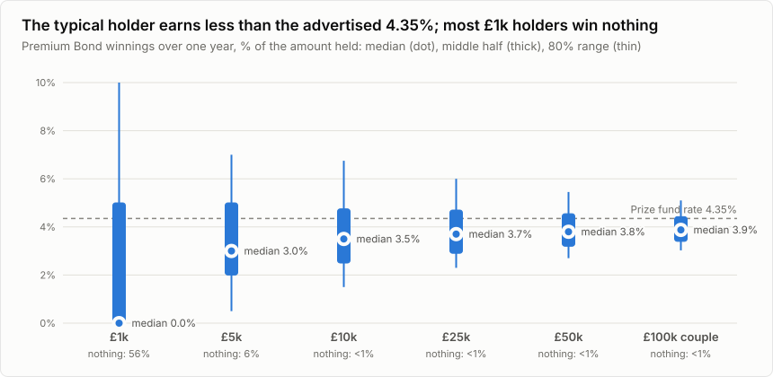
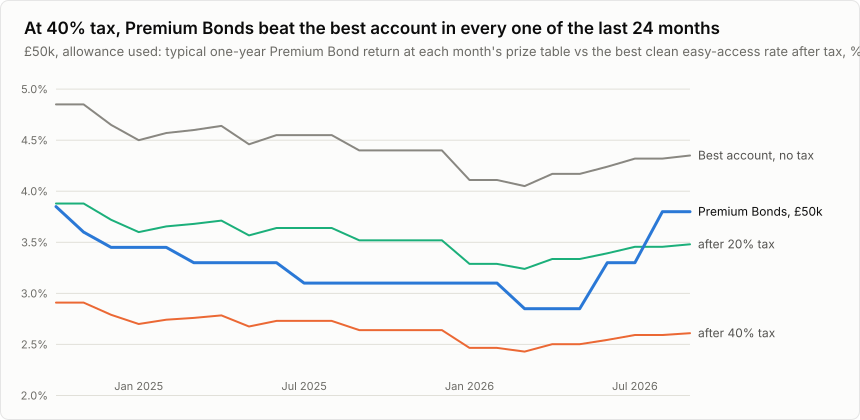
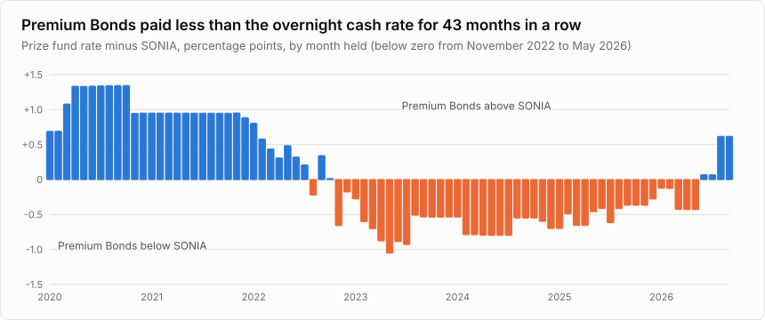

*Premium Bonds pay no interest, only prizes, and the prizes are tax-free. Is that a better deal than a savings account, a money market fund or a gilt once tax, fees and luck are counted? It depends on how much you hold and what tax you pay. Here is how much.*

*This article is rebuilt from the latest rates each month. Rates as of 11 October 2026: the October 2026 Premium Bond draw, best buys on 11 October 2026.*

## The short version

Premium Bonds advertise a "prize fund rate" of 4.35%. That is the average across all 137.5 billion bonds. It is not what a typical holder gets, because a few big prizes pull the average up. And it is tax-free, which matters a lot to some savers and not at all to others.

So I worked out the whole spread of outcomes for every amount you can hold, and set them against the best alternatives after tax at every level of income and after every fee.

**The answer: Premium Bonds are a good deal for higher-rate taxpayers who have used their tax-free savings allowance, and a poor one for anyone who pays no tax on their savings.** Seven things stand out:

- **The typical holder earns less than 4.35%.** Hold £10,000 for a year and the typical (median) holder wins £350, or 3.5%; one in ten wins £150 or less. With £1,000, 56% win nothing at all. Even at the £50,000 maximum the typical return is 3.8% (Figure 1). On average, counting the rare big prizes, holders do get 4.35%; most just get less than average.
- **If you have ISA allowance left, use it first.** A cash ISA paying 4.26% with easy access, or 4.97% fixed for a year, beats the typical Premium Bond holding for everyone, tax-free.
- **Outside an ISA, tax decides.** Against the best easy-access account (4.52%), Premium Bonds win for a higher-rate taxpayer who has used their savings allowance: by 0.8 percentage points a year on £10,000 and 1.1 on £50,000 (Figure 2). New money gets only 11 draws in its first year, which cuts that edge on £50,000 to 0.7 points.
- **For anyone who pays no tax on their interest, the bank wins.** The typical Premium Bond holder with £10,000 is 1.0 points behind; even on average the gap is 0.2 points.
- **If you can tie money up, a fix or a gilt beats the typical Premium Bond.** A one-year fixed account pays 5.13%. A low-coupon government bond held to 31 January 2028 returns 4.16%-4.23% a year on £50,000 after tax and fees, whatever your tax band, because almost all of its return is a tax-free capital gain.
- **The money market fund never wins here.** The Royal London fund yields 3.85% after its charge, and 3.60% after a typical platform fee: 0.9 points below the best easy-access account before tax. Its case is convenience inside an investment account.
- **Premium Bonds don't follow Bank Rate.** For 43 months in a row, from November 2022 to May 2026, they paid less than SONIA, the overnight rate banks lend to each other at. In 2026 Bank Rate stood still, yet NS&I changed the prize rate three times, rising twice after one-year gilt yields jumped (Figure 4).
- **The last two years tell much the same story.** From the November 2024 to the October 2026 draw the prize rate averaged 3.78%. On £50,000 the typical holder made 3.35% a year. A non-taxpayer who moved to the best clean easy-access account every month made 4.52%; a higher-rate saver with the allowance used made 2.71% after tax, so Premium Bonds beat the account for them.

All of this is for one person's savings at today's rates, which will change. The £50,000 Premium Bond limit is per person, so a couple can hold £100,000. Premium Bonds and the gilt are backed by the Treasury; bank deposits are protected up to £120,000 per banking licence; the money market fund is not protected as a deposit. Inflation was 3.1% in August 2026: take it off any figure here to see what your savings gain in spending power.

*Disclosure: the content of this article was generated by Claude Opus 5.5. The study plan was reviewed by Claude Fable 5.1 before the analysis was run; data collection was split between Claude Opus 5.5 and its subagents, and collected figures were checked by scripts against the saved sources. This version was reviewed independently by Claude Opus 5.5 and Claude Fable 5.1, and their findings were addressed.*

---

## 1. What Premium Bonds really pay

### 1.1 The typical holder earns less than the advertised rate

Each £1 bond goes into a monthly draw. In October 2026 NS&I paid out 6,546,849 prizes from 137.5 billion bonds: odds of 21,000 to 1 per bond per month. The prize fund is set so that the *average* return is 4.35% a year. But 10% of the fund goes on prizes of £5,000 to £1 million, and most holders never see one: with £10,000 the chance of any prize of £5,000 or more in a year is 0.3%; with £50,000, 1.5%. Take those away and the typical holder lives on £25, £50 and £100 prizes.

Because every bond has the same chance and prize values are fixed, the full spread of outcomes for any holding can be worked out exactly, with no simulation (see "How this was done").

**Table 1. One year of Premium Bonds, by amount held** (12 draws, prizes paid out; October 2026 prize table)

| Amount | Win nothing | Unlucky (1 in 10) | Typical (median) | Lucky (1 in 10) | Typical, a year over 5 years |
|---|---|---|---|---|---|
| £100 | 94% | £0 (0.0%) | **£0 (0.0%)** | £0 (0.0%) | 0.0% |
| £1,000 | 56% | £0 (0.0%) | **£0 (0.0%)** | £100 (10.0%) | 3.0% |
| £5,000 | 6% | £25 (0.5%) | **£150 (3.0%)** | £350 (7.0%) | 3.7% |
| £10,000 | <1% | £150 (1.5%) | **£350 (3.5%)** | £675 (6.8%) | 3.8% |
| £25,000 | <1% | £575 (2.3%) | **£925 (3.7%)** | £1,500 (6.0%) | 3.9% |
| £50,000 | <1% | £1,350 (2.7%) | **£1,900 (3.8%)** | £2,725 (5.5%) | 3.9% |

Unlucky and lucky are the 10th and 90th percentiles: one holder in ten does worse than the first, one in ten better than the second. The table assumes prizes are paid out, as they must be at the £50,000 maximum; the average is then 4.35%. Reinvesting prizes below the maximum lifts the average to 4.44%. Luck evens out with time and size: over five years, half of £10,000 holders earn between 3.2% and 4.6% a year, and eight in ten between 2.7% and 5.5%, with a typical 3.8%.

### 1.2 New money loses about a month of prizes

A bond bought in any month first enters the draw a month after next: buy in mid-October and your first draw is December. It stays in each month's draw as long as you still hold it on the 1st. And a cash-in requested in the last two working days of a month is held back until after the next draw, so it keeps that draw. Each draw is worth 0.36% at today's rate, so timing matters.

**Table 2. Typical (median) winnings for new money held about a year, by timing**

| Bought | Cash-in requested | Days to the request | Draws | £10,000 | £50,000 |
|---|---|---|---|---|---|
| 30 October 2026 | 2 November 2027 | 368 | 12 | £350 | £1,900 |
| 15 October 2026 | 29 October 2027 | 379 | 12 | £350 | £1,900 |
| 15 October 2026 | 15 October 2027 | 365 | 11 | £325 | £1,725 |
| 1 October 2026 | 1 October 2027 | 365 | 11 | £325 | £1,725 |
| 1 October 2026 | 24 September 2027 | 358 | 10 | £300 | £1,575 |

Money held for a year from mid-month gets 11 draws. To get 12, buy at the end of a month and either cash in just after the 1st a year later, or ask in the last two working days of the month (the money then arrives after the next draw). Buy on the 1st and cash in before the last two working days of the month just under a year later, and you get 10. Money already in Premium Bonds has no such cost. Cash-ins take 3 to 5 days.

## 2. After tax and fees, Premium Bonds win clearly only in the higher tax bands

### 2.1 The best accounts pay more than the prize rate

**Table 3. What each option pays today, before tax**

| Option | Rate | Product | As of | Source |
|---|---|---|---|---|
| Premium Bonds | 4.35% prize fund rate, tax-free |  | October 2026 draw | NS&I |
| Best easy access | 4.52% | cahoot Simple Saver (Issue 20) | 11 October 2026 | Moneyfacts |
| Best 1-year fix | 5.13% | OakNorth Bank Fixed Term Savings Account | 11 October 2026 | Moneyfacts |
| Best easy-access cash ISA | 4.26%, tax-free | Charter Savings Bank Easy Access Cash ISA Issue 82 | 11 October 2026 | Moneyfacts |
| Best 1-year fixed cash ISA | 4.97%, tax-free | Shawbrook Bank 1 Year Fixed Rate Cash ISA Plus - Issue 1 | 11 October 2026 | Moneyfacts |
| NS&I Direct Saver | 3.75% |  | from 18 August 2026 | NS&I |
| Money market fund | 3.95% yield, 3.85% after its 0.10% charge | Royal London Short Term Money Market Fund | 28 August 2026 | Royal London |
| Gilt | 4.29% to maturity | 0 1/8% Treasury Gilt 2028 (TN28), price 94.79 | 9 October 2026 | Hargreaves Lansdown |
| Average easy-access account | 1.90% | Advertised rate, excluding bonuses | September 2026 | Bank of England |
| Bank Rate | 3.75% |  | September 2026 | Bank of England |

"Best easy access" means the top account with no introductory bonus, no limit on withdrawals, no linked current account, open to new customers anywhere in the UK, opened directly with the bank rather than through a savings platform, taking anything from £1,000 to £50,000, with deposit protection. Bonus-boosted accounts pay more for a few months, then drop; even the top clean accounts often move to a lower rate after a year. Accounts most people hold pay far less: the average rate advertised on new easy-access accounts is 1.90%, and big banks pay 1-2%. NS&I's own Direct Saver pays 3.75%, less than the best accounts but with the same unlimited Treasury guarantee as Premium Bonds.

The rates are not all quoted the same way. The prize fund rate is an average, not an AER (4.44% with prizes reinvested). The gilt's yield is quoted with twice-yearly compounding, as the gilt market quotes it; the after-tax figures below use annual rates throughout. The fund's yield is the latest Royal London publishes, at 28 August 2026.

### 2.2 Who comes out ahead

Tax is what separates the options. Bank interest and the money market fund's income are taxed as savings income, after a tax-free allowance of £1,000 for basic-rate taxpayers and £500 for higher-rate taxpayers (nothing for the additional rate), plus a £5,000 band for people on low incomes. Interest also counts towards the income tests for child benefit and the personal allowance, so in some bands an extra £1 of interest costs more than the headline tax rate. Premium Bond prizes count towards none of it.

I worked the sums for eight savers. "Allowance used" means the saver already has other interest that uses up their tax-free allowance, so every £1 more is taxed. The comparison is for a year of 12 draws: money already in Premium Bonds, or new money timed as in section 1.2.

In 16 of the 40 combinations the typical Premium Bond holder comes out ahead of the best easy-access account (Figure 2); for new money's first year, with 11 draws, in 13. The pattern:

- **No tax on interest: the bank wins.** This covers pensioners on the full State Pension alone, who can earn about £6,020 of interest tax-free, and anyone whose interest fits inside their allowance.
- **Basic rate: close to a draw.** With the allowance used, the typical Premium Bond holder is 0.1 points behind on £10,000 and 0.2 points ahead on £50,000.
- **Higher rate: Premium Bonds win from £5,000 once the allowance is used, and from £25,000 even if it isn't.** On £10,000 the typical holder is 0.8 points ahead with the allowance used; on £50,000, 1.1.
- **Higher rate with the child benefit charge: Premium Bonds win from £25,000.** With two children, each £1 of interest costs 11.7% in charge inside the allowance and 51.7% above it, on average (the charge rises in £200 steps).
- **The 60% band: Premium Bonds win from £25,000.** Between £100,000 and £125,140, each £1 of interest above the allowance costs 60p, because it also takes away personal allowance. Interest that takes you over £100,000 can also cost you tax-free childcare and free childcare hours, which stop there.
- **Additional rate: Premium Bonds win from £5,000.**

These compare the typical holder. On average Premium Bonds pay 4.35%, so the average gap is smaller: for a non-taxpayer with £10,000 it is 0.2 points, not 1.0. The typical figure is what most holders get.

**Table 4. Return after tax and fees on £10,000, % a year, today's rates held for a year**

| Saver | Premium Bonds, typical (unlucky-lucky) | Best easy access | Best 1-year fix | Money market fund (AJ Bell) | Gilt to Jan 2028 | Chance Premium Bonds beat easy access |
|---|---|---|---|---|---|---|
| Pays no tax on interest | 3.5% (1.5%-6.8%) | 4.52% | **5.13%** | 3.57% | 4.03% | 28% |
| Basic rate, allowance unused | 3.5% (1.5%-6.8%) | 4.52% | **5.13%** | 3.57% | 4.03% | 28% |
| Basic rate, allowance used | 3.5% (1.5%-6.8%) | 3.62% | **4.10%** | 2.80% | 4.00% | 47% |
| Higher rate, allowance unused | 3.5% (1.5%-6.8%) | 4.52% | **5.08%** | 3.57% | 4.03% | 28% |
| Higher rate, allowance used | 3.5% (1.5%-6.8%) | 2.71% | 3.08% | 2.03% | **3.97%** | 69% |
| Higher rate + child benefit charge (2 children), allowance unused | 3.5% (1.5%-6.8%) | 3.99% | **4.48%** | 3.12% | 4.02% | 42% |
| £100k-£125k (60% band) | 3.5% (1.5%-6.8%) | 3.62% | **4.05%** | 2.80% | 4.00% | 47% |
| Additional rate (45%) | 3.5% (1.5%-6.8%) | 2.49% | 2.82% | 1.84% | **3.96%** | 75% |

The best of the five for each saver is in bold. The fix and the gilt tie your money up; the others don't.

**Table 5. The same on £50,000**

| Saver | Premium Bonds, typical (unlucky-lucky) | Best easy access | Best 1-year fix | Money market fund (AJ Bell) | Gilt to Jan 2028 | Chance Premium Bonds beat easy access |
|---|---|---|---|---|---|---|
| Pays no tax on interest | 3.8% (2.7%-5.5%) | 4.52% | **5.13%** | 3.59% | 4.23% | 26% |
| Basic rate, allowance unused | 3.8% (2.7%-5.5%) | 4.02% | **4.50%** | 3.22% | 4.23% | 41% |
| Basic rate, allowance used | 3.8% (2.7%-5.5%) | 3.62% | 4.10% | 2.82% | **4.20%** | 57% |
| Higher rate, allowance unused | 3.8% (2.7%-5.5%) | 3.11% | 3.48% | 2.45% | **4.23%** | 77% |
| Higher rate, allowance used | 3.8% (2.7%-5.5%) | 2.71% | 3.08% | 2.05% | **4.17%** | 89% |
| Higher rate + child benefit charge (2 children), allowance unused | 3.8% (2.7%-5.5%) | 2.58% | 2.88% | 2.00% | **4.21%** | 93% |
| £100k-£125k (60% band) | 3.8% (2.7%-5.5%) | 2.21% | 2.45% | 1.68% | **4.20%** | 98% |
| Additional rate (45%) | 3.8% (2.7%-5.5%) | 2.49% | 2.82% | 1.86% | **4.16%** | 95% |

The best of the five for each saver is in bold. The fix and the gilt tie your money up; the others don't.

The Premium Bond column shows the typical holder, with the unlucky and lucky outcomes in brackets. On £10,000 several rows match because the interest fits inside the tax-free allowance. Tax is at 2026/27 rates; interest paid after 5 April 2027 faces the higher rates in section 7.

**Table 6. The typical Premium Bond holder minus the best easy-access account, percentage points: money already held (12 draws) and new money's first year (11 draws)**

| Saver | £10,000, held | £10,000, new money | £50,000, held | £50,000, new money |
|---|---|---|---|---|
| Pays no tax on interest | −1.0 | −1.3 | −0.7 | −1.1 |
| Basic rate, allowance unused | −1.0 | −1.3 | −0.2 | −0.6 |
| Basic rate, allowance used | −0.1 | −0.4 | +0.2 | −0.2 |
| Higher rate, allowance unused | −1.0 | −1.3 | +0.7 | +0.3 |
| Higher rate, allowance used | +0.8 | +0.5 | +1.1 | +0.7 |
| Higher rate + child benefit charge (2 children), allowance unused | −0.5 | −0.7 | +1.2 | +0.9 |
| £100k-£125k (60% band) | −0.1 | −0.4 | +1.6 | +1.2 |
| Additional rate (45%) | +1.0 | +0.8 | +1.3 | +1.0 |

Another way to read it: the rate a taxable account would need to pay to match the typical Premium Bond holder.

**Table 7. The interest rate a taxable account must pay to match the typical Premium Bond holding (12 draws)**

| Saver | £5,000 | £10,000 | £25,000 | £50,000 |
|---|---|---|---|---|
| Pays no tax on interest | 3.00% | 3.50% | 3.70% | 3.80% |
| Basic rate, allowance unused | 3.00% | 3.50% | 3.70% | 4.25% |
| Basic rate, allowance used | 3.75% | 4.38% | 4.63% | 4.75% |
| Higher rate, allowance unused | 3.00% | 3.50% | 4.83% | 5.67% |
| Higher rate, allowance used | 5.00% | 5.83% | 6.17% | 6.33% |
| Higher rate + child benefit charge (2 children), allowance unused | 3.40% | 3.96% | 6.00% | 7.04% |
| £100k-£125k (60% band) | 3.75% | 4.38% | 7.25% | 8.50% |
| Additional rate (45%) | 5.45% | 6.36% | 6.73% | 6.91% |

### 2.3 If you can tie money up, a fix or a gilt pays more

UK government bonds (gilts) are as safe as Premium Bonds: both are Treasury debt. A gilt pays a small fixed coupon and repays £100 at maturity. Low-coupon gilts trade below £100, and the rise to £100 is a capital gain that is free of capital gains tax. Only the tiny coupon is taxed.

The 0 1/8% Treasury Gilt 2028 (TN28) cost 94.79 on 9 October 2026 and matures on 31 January 2028. Before tax it yields 4.29% a year. After tax and AJ Bell's dealing fee (£5) and account fee (capped at £42 a year), it returns 3.96%-4.03% a year on £10,000 and 4.16%-4.23% on £50,000, whatever your tax band (Tables 4 and 5). That beats the typical Premium Bond holding for every saver in the tables, though not the 4.35% average.

The one-year fixed account (5.13%) is simpler and, where little of its interest is taxed, pays more than the gilt: for anyone who pays no tax on their interest, and for most savers on £10,000. Once enough of the fix's interest is taxed (at 40% or more, or at 20% on £50,000), the gilt wins, because its return is almost all tax-free.

The catches: both tie your money up (the gilt until 31 January 2028, the fix for a year), you need a broker account for the gilt, and if you sell the gilt early its price may have moved. Its return is fixed only if you hold to the end.

## 3. Only the money market fund charges fees, and on small pots they bite

Premium Bonds, bank accounts and NS&I accounts charge nothing. The money market fund charges 0.10% a year inside the fund, and the platform you hold it on charges again.

**Table 8. Holding the Royal London money market fund: platform charge and what's left, before tax**

| Platform | £5,000 pot | £10,000 pot | £50,000 pot | £100,000 pot |
|---|---|---|---|---|
| AJ Bell | £12 → 3.60% | £25 → 3.60% | £125 → 3.60% | £250 → 3.60% |
| Hargreaves Lansdown | £18 → 3.50% | £35 → 3.50% | £175 → 3.50% | £350 → 3.50% |
| Fidelity | £90 → 2.05% | £90 → 2.95% | £175 → 3.50% | £350 → 3.50% |
| interactive investor | £72 → 2.41% | £72 → 3.13% | £72 → 3.71% | £72 → 3.78% |

Each cell: platform charge a year → the fund's yield left after both charges, before tax and before dealing fees (at AJ Bell, £1.50 each time you buy or sell).

At AJ Bell or Hargreaves Lansdown the fee is a percentage; at Fidelity, small pots pay a flat £90 a year; at interactive investor the flat fee covers the whole account, so it costs nothing extra if you already pay it. On a £5,000 pot at Fidelity, the fund keeps just 2.05% a year. Whatever the platform, the fund yields 3.85% after its own charge, below the best easy-access account's 4.52%, and its income is taxed the same way. Even an accumulation fund, which pays nothing out, is taxed each year on the income it reinvests.

## 4. The last two years: the same pattern, realised

Today's rates are a snapshot. Here is what each option actually paid over the last 24 draws, November 2024 to October 2026 (deposits and the fund over October 2024 to September 2026, the months those draws reward). Tax is worked out separately for each of the two 12-month blocks (not tax years), with one savings allowance each, under the rules of the tax year each block starts in; the savings tax rules did not change over the period. The prize rate averaged 3.78%.

Month by month, the typical £50,000 holding beat the best easy-access account after 40% tax (allowance used) in all 24 months, and after 20% tax in 2 (Figure 3). August 2026 has no archived best-buy page, so the previous month's rate is carried forward. One difference: a basic-rate saver with the allowance used did better in the account (3.62% against 3.35%), where today's rates give Premium Bonds a small edge.

**Table 9. What £50,000 actually earned, a year, after tax and fees, over the last two years**

| Saver | Premium Bonds, typical | Best-buy chaser | Average easy-access account | Two 1-year fixes | Money market fund (AJ Bell) | Chance Premium Bonds beat the chaser |
|---|---|---|---|---|---|---|
| Pays no tax on interest | 3.35% | 4.52% | 2.21% | **4.78%** | 4.12% | 9% |
| Basic rate, allowance unused | 3.35% | 4.02% | 2.17% | **4.23%** | 3.65% | 20% |
| Basic rate, allowance used | 3.35% | 3.62% | 1.77% | **3.83%** | 3.25% | 36% |
| Higher rate, allowance unused | **3.35%** | 3.11% | 1.73% | 3.27% | 2.77% | 64% |
| Higher rate, allowance used | **3.35%** | 2.71% | 1.33% | 2.87% | 2.37% | 85% |
| Higher rate + child benefit charge (2 children), allowance unused | **3.35%** | 2.61% | 1.48% | 2.74% | 2.28% | 89% |
| £100k-£125k (60% band) | **3.35%** | 2.21% | 1.29% | 2.31% | 1.89% | 98% |
| Additional rate (45%) | **3.35%** | 2.49% | 1.22% | 2.63% | 2.15% | 93% |

The "best-buy chaser" moved to the top clean easy-access account at the start of every month, the best a saver could have done with instant access under the rule in section 2.1 (the two 1-year fixes did better still, with the money tied up); the average account is the average rate advertised on new easy-access accounts (money left in old accounts typically earned less), and Premium Bonds beat it for every saver. The two 1-year fixes were the best buys in October 2024 and a year later. The money market fund is its actual return after its charge, taxed, then AJ Bell's fee at today's tariff. Every figure is the total two-year gain after tax and fees, divided by two: what £50,000 earned a year, on average.

## 5. Premium Bonds don't follow Bank Rate; in 2026 they rose after gilt yields jumped

NS&I sets the prize rate to raise a set amount of money for the government each year, not by formula. The Treasury approves the rate and NS&I says it balances "the interests of savers, taxpayers and the stability of the broader financial services sector". So the rate moves with the cost of government borrowing and with what banks pay, at its own pace. Three episodes show how:

- **On the way up, Premium Bonds lagged.** The Bank of England first raised rates on 16 December 2021. NS&I's first rise was announced on 24 May 2022, 5 months later. Bank Rate went from 0.10% to 5.25%; the prize rate from 1.00% to 4.65%.
- **On the way down, Premium Bonds led.** NS&I announced its first cut on 11 January 2024, 7 months before the Bank's first cut on 1 August 2024.
- **In 2026 Bank Rate stood still.** It stayed at 3.75% all year. NS&I cut the prize rate in February, when the one-year gilt yield was 3.42%; the yield then jumped to 4.25% in March, and NS&I raised the prize rate twice, to 4.35% by September, citing the wider savings market and its fund-raising target.

So comparing Premium Bonds with Bank Rate is misleading. For 43 months in a row, from November 2022 to May 2026, the prize rate sat below SONIA, the overnight rate banks lend to each other at, which money market funds roughly earn (Figure 5). Months here are the months the bonds were held; each pays out in the next month's draw. Since mid-2026 the prize rate has been above SONIA. Against the average easy-access account it has been comfortably ahead throughout, by about 1.7 points a year since 2023.

NS&I gave between 4 and 71 days' notice of each of the 17 changes since 2020.

**Table 10. Every change in the Premium Bond prize rate since 2020**

| Announced | First draw | Prize rate | Days since Bank Rate last moved | Change in 1-year gilt yield in the 3 months before the announcement month (points) |
|---|---|---|---|---|
| 21 September 2020 | December 2020 | 1.40% → 1.00% | 186 | −0.06 |
| 24 May 2022 | June 2022 | 1.00% → 1.40% | 19 | +0.59 |
| 27 September 2022 | October 2022 | 1.40% → 2.20% | 5 | +1.38 |
| 13 December 2022 | January 2023 | 2.20% → 3.00% | 40 | +0.38 |
| 24 January 2023 | February 2023 | 3.00% → 3.15% | 40 | −0.56 |
| 14 February 2023 | March 2023 | 3.15% → 3.30% | 12 | +0.29 |
| 20 June 2023 | July 2023 | 3.30% → 3.70% | 40 | +0.60 |
| 30 June 2023 | August 2023 | 3.70% → 4.00% | 8 | +0.60 |
| 8 August 2023 | September 2023 | 4.00% → 4.65% | 5 | +0.89 |
| 11 January 2024 | March 2024 | 4.65% → 4.40% | 161 | −0.58 |
| 22 October 2024 | December 2024 | 4.40% → 4.15% | 82 | −0.42 |
| 26 November 2024 | January 2025 | 4.15% → 4.00% | 19 | +0.04 |
| 18 February 2025 | April 2025 | 4.00% → 3.80% | 12 | −0.32 |
| 24 June 2025 | August 2025 | 3.80% → 3.60% | 47 | −0.23 |
| 24 February 2026 | April 2026 | 3.60% → 3.30% | 68 | −0.10 |
| 14 May 2026 | July 2026 | 3.30% → 3.80% | 147 | +0.72 |
| 18 August 2026 | September 2026 | 3.80% → 4.35% | 243 | −0.10 |

## 6. Treasury backing has no limit; bank protection stops at £120,000

**Table 11. How safe, and how quick**

| Option | Protection | Getting money out | Limits |
|---|---|---|---|
| Premium Bonds | 100% Treasury-backed | 3 to 5 days; prizes only for whole months held | £25 to £50,000 |
| Bank or building society account | FSCS, £120,000 per banking licence | Same day (easy access); locked (fixed) | Varies |
| NS&I Direct Saver | 100% Treasury-backed | Easy access | Up to £2m |
| Money market fund | Not a deposit; FSCS investment cover (£85,000) only if a firm fails owing you assets | A few days | None |
| Gilt | UK government | Sell any trading day, at the market price | None |

## 7. April 2027 tilts the answer slightly towards Premium Bonds

Two changes are already law. Tax on savings income rises by 2 percentage points, to 22%, 42%, 47%. And the cash ISA limit falls to £12,000 a year for people under 65 (the overall ISA limit stays £20,000). Both push in Premium Bonds' favour, a little: with the allowance used, the edge on £50,000 grows from 1.1 to 1.2 points for a higher-rate saver, and from 0.2 to 0.3 for a basic-rate saver. The Budget on 28 October 2026 could change either.

## 8. What this can't tell us

- **Future rates.** "Today's rates" assumes they hold for a year. They won't: banks cut and raise easy-access rates at will, and NS&I changes the prize rate several times a year (Table 10).
- **Your own tax position.** The eight savers are examples. Pension contributions, Gift Aid and other income all shift the bands. Interest can itself push you over a line: crossing £50,270 of total income halves the tax-free allowance. Scottish taxpayers pay UK rates on savings income, so pick your row by the UK bands: a Scottish taxpayer earning up to £50,270 is a basic-rate saver here, whatever rate they pay on wages. In the £100,000-£125,140 band their cost is 62.5% rather than 60%.
- **Effort and behaviour.** The best easy-access account changes often, and the trailing "best-buy chaser" switched every month, at the start of the month. Few people do.
- **Gaps in the best-buy history.** Archived best-buy pages were missing for August 2026; the previous month's best buy is carried forward.
- **Risk beyond the tables.** The money market fund holds mostly short loans to banks; it is very safe, but it is not a deposit. The gilt is safe if held to maturity, but its price moves before then.

## 9. How this was done

**Premium Bonds.** For each monthly draw I took the official count of prizes at each value from NS&I's winning-numbers files (all 82 draws from January 2020 to October 2026; each count sums exactly to the published total) and the number of eligible bonds. Each £1 bond has the same chance of each prize, so the distribution of total winnings for any holding over any run of draws is a convolution of the per-draw prize tables; I computed it exactly with a fast Fourier transform on a £25 grid, with prizes paid out. The average with prizes reinvested is exact too, because averages add up draw by draw; a simulation of true reinvestment agrees. The method reproduces MoneySavingExpert's published medians (£350, £925, £1,900 for £10k, £25k and £50k) and its chance-of-beating table to within 0.5 points, and the old simulation it replaces.

**Rivals.** Best buys from Moneyfacts' best-buy tables, filtered by the rule in section 2.1: Moneyfacts' own search tests the £1,000 and £50,000 limits, and conditions its data does not show are checked against MoneySavingExpert's best-buy pages. For the past two years, archived pages were coded by hand to the same rule, and the automatic filter, run on those archived pages, picks the same rate on 39 of 41 archived pages, easy-access and one-year-fix (the others are an account with a deposit limit that a single archived search cannot test). Average rates and Bank Rate come from the Bank of England; the money market fund's yield from Royal London and its daily prices from the FT (which reproduce Royal London's published five-year return to 0.003 points); NS&I rates from NS&I; the gilt price from Hargreaves Lansdown; platform charges from each platform's tariff page; inflation from the ONS.

**Tax.** A tax calculator for savings income: personal allowance and its taper, the £5,000 starting rate band, the personal savings allowance (set by total income including the interest), UK savings rates (also for Scottish taxpayers), and the child benefit charge. It matches 18 test cases to the penny: one from gov.uk's worked examples, the rest worked by hand from the legislation. The money market fund is taxed on its income after the fund's charge; platform fees come off after tax. The gilt's coupon is taxed; its rise to £100 is not.

**Updating.** Each month, after the draw, a script fetches the new prize table, NS&I's rates, the Bank of England series, best buys, fund prices and inflation, re-runs every check, and rebuilds this page. Tax rules sit in a dated file updated after each Budget.

**Replication.** Code, tables and the source list: [replication.zip](replication.zip).
