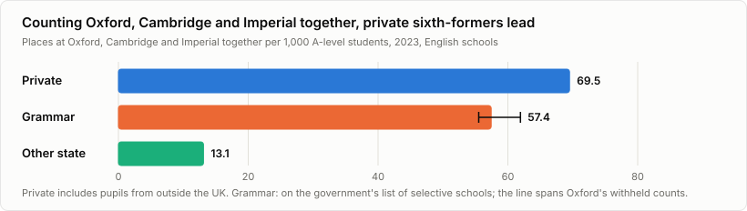
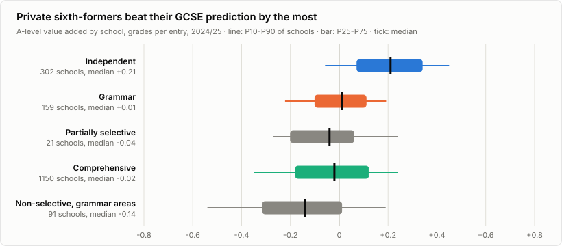
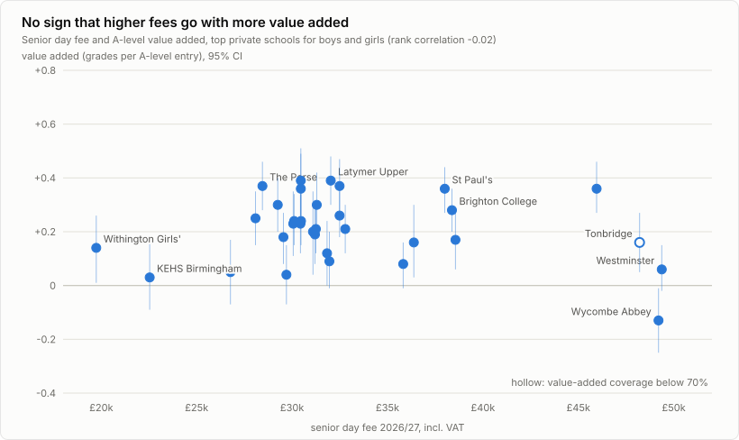
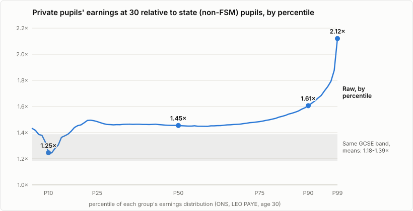
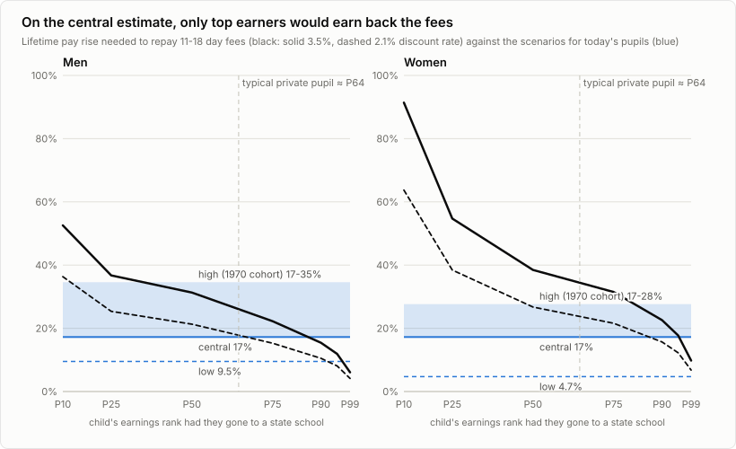
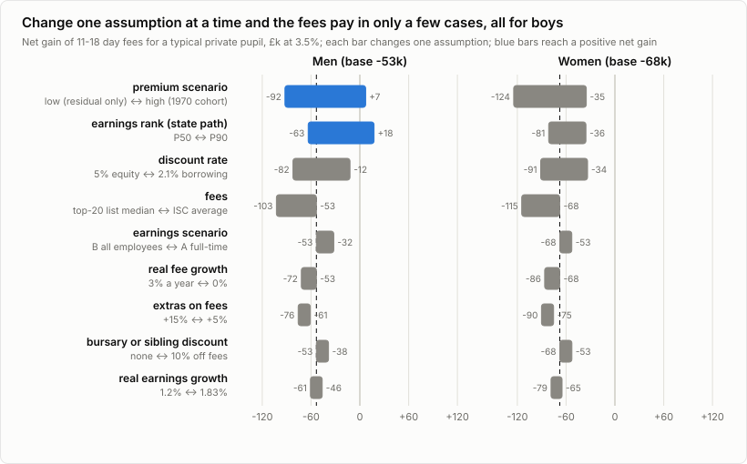

*Private and grammar schools get great results. How much of that is the school, and how much is who gets in? And at today's fees, does private school pay?*

## The short version

Children at private and grammar schools get better A levels, go to better universities and earn more than children at comprehensives. None of that is in doubt. The question is why. These schools pick their pupils, by price or by test, and the pupils they pick would often have done well anywhere.

So I took the question apart. First the raw gaps; then the gaps once you compare like with like; then the money: what 11-18 day fees cost against what the extra pay is worth, after tax, over a whole career.

**The answer, on the best evidence available: for a typical pupil, private day school probably does not pay for itself in earnings.** In today's money, a boy ends up about £53k worse off and a girl about £68k. Put another way, the fees earn 1.8% a year above inflation for a boy and 1.3% for a girl: less than index-linked gilts, UK government bonds that rise with inflation, pay at almost no risk (1.9%-2.4%). The evidence is loose enough that a typical boy could just break even (+£7k); a typical girl would still lose (−£18k). At the top 20 schools, where fees are higher, the loss grows to about £103k for a boy and £115k for a girl.

Five things stand out:

- **Grammar pupils match private pupils on grades and on getting to university. On most other measures, private pupils are ahead.** Both average about a B+ per A level (41.6 and 42.9 points), and by 19 88.8% of grammar and 86.9% of private sixth-formers are at university, against 77.2% elsewhere. But private sixth-formers beat the prediction from their GCSEs by more (+0.20 of a grade per A level, against +0.01), more of them go to the universities with the highest entry grades (58.6% against 50.2%), and 21% more per A-level student go to Oxford, Cambridge and Imperial College London together (Figure 1); grammars lead only at Cambridge (Figure 2). Later in life, among people born in 1970, the privately educated were 1.5-1.6 times as likely as grammar pupils to be higher managers or professionals at 42, and grammar pupils 1.7 times as likely as comprehensive pupils. Among the UK's leading scientists and scholars, mostly at school before the 1960s, private schools produced 6.9× their share of pupils, grammars 1.7×. All of these are raw gaps, and much of each comes from the pupils rather than the school.
- **Much of the pay gap comes from the pupils, not the school.** At 30, the middle private-school earner makes 1.45 times what the middle state-school earner makes (leaving out pupils on free school meals). In studies that compare people from similar families, 37% to 71% of each study's raw pay gap disappears. For the most recent generation studied, born in 1989-90, a pay advantage of about 17% remains. Chance alone puts the true figure between 5% and 31%, and it may be lower still: that study had no early test scores to allow for. For grammar schools, children who just passed the 11-plus earn about the same as those who just missed it.
- **The fees set a high bar.** Day fees from 11 to 18 are worth £149k in today's money. To earn that back, a typical private pupil would need to earn about 27% more for life (boys) or 33% more (girls). The central estimate is 17%.
- **Moving house can be a cheaper option, and a grammar place cheaper still.** Moving into a good state school's catchment in London costs about £65k if the school is your only reason to move, about £29.9k of it stamp duty. A grammar place costs only the tutoring.
- **Beyond pay, private pupils reach the top more often.** On raw numbers, they start PhDs at 2.6 times the average rate and are over-represented in 42 of 46 elite groups.

On A levels, pupils at the top private schools beat their GCSE-based prediction by about +0.21 of a grade; at the top grammars, by +0.05. And there's no sign that paying more buys more of it.

All of this describes averages, not any particular child or school. The pay evidence comes from people who were at school between the 1960s and the 2000s, and some of what remains may still be who gets in rather than what the school does. Money is also only one reason families choose a school.

*Disclosure: this article was written with help from Anthropic's AI models Claude Opus and Claude Fable, which assembled the data and reviewed the plan and the analysis. Collected figures were checked by scripts against the saved sources.*

---

## 1. How to compare schools fairly

### 1.1 Three kinds of comparison

Every number in this article is one of three kinds, and the difference matters:

- **Raw.** The plain gap between pupils at different kinds of school. It mixes what the school does with who it lets in.
- **Allowing for intake.** Compares pupils who were alike *before* they started: similar family backgrounds and, where available, similar test scores at 7, 10 or 11. It is the best comparison most of these sources allow. Even so, it can't prove the school caused the difference, because families who choose private school may differ in ways no survey records.
- **Allowing for later results.** Also compares pupils with the same GCSEs, A levels, degree or university. Those are partly the school's doing, so this strips out some of the school's own effect. What's left is the advantage beyond exam results.

"Comprehensive" here means a non-selective state school outside the areas that still have grammar schools. Two groups are kept apart: non-selective schools inside grammar areas (today's secondary moderns), and the 24 schools that pick some pupils by ability ("partially selective", such as Dame Alice Owen's and the Watford grammars). England only.

### 1.2 Reading the numbers

- **Percentile.** Rank out of 100. Someone "at the 64th percentile" of earnings earns more than 64 in every 100 people of the same sex and age. The 50th percentile is the middle.
- **Today's money.** A pound in 20 years is worth less than a pound now, because money now can be saved or used to pay off a mortgage. So future amounts are marked down by a set rate each year, the *discount rate*, to give their value today. I use HM Treasury's rule for public spending (the "Green Book"): 3.5% a year for 30 years, then 3.0%. I also show 2.1%, roughly the cost of a mortgage after inflation, and the yields on index-linked gilts: UK government bonds whose payments rise with inflation, so their yield is what a saver can earn above inflation at almost no risk if they hold to the end. Those yields were 1.9%-2.4% for 10 to 40 years on 4 November 2026, and each future amount is marked down at the yield for its date. All amounts are in 2025/26 prices.
- **Net gain.** The value today of the extra lifetime pay after tax, minus the value today of the fees. Below zero means the fees don't pay for themselves.
- **Return on the fees.** The yearly interest rate the fees would be earning if the extra pay were interest on them. The fees pay if this beats the discount rate.
- **Range (95% interval).** Where the true figure very probably lies, given how many people a study observed. It covers the luck of who happened to be in the study, not flaws in the comparison itself.
- **Value added.** How much better pupils do at A level than pupils elsewhere with the same GCSEs, in grades per A level. Positive means better than predicted, negative worse. In investors' terms it is the school's "alpha": the return beyond what pupils' GCSEs predict.
- **Progress 8.** The same idea for GCSEs, measured against national tests at 11.

### 1.3 Everything on one page


| Outcome | Private | Grammar | Comprehensive | Kind of comparison and source |
|---|---|---|---|---|
| Went to university by 19 (A-level students) | 86.9% | 88.8% | 77.2% (all other state) | Raw; DfE, pupils aged 15 in 2020/21 |
| Went to a high-entry-grade university by 19 | 58.6% | 50.2% | 24.2% (all other state) | Raw; DfE |
| Cambridge places per 1,000 A-level students, 2023 | 21.3-24.0 | 26.2 | 5.2 (all other state) | Raw; Cambridge and DfE, English schools |
| Oxford places per 1,000 A-level students, 2023 | 23.6-25.9 | 17.1 | 5.0 (all other state) | Raw; Oxford and DfE, English schools |
| Imperial places per 1,000 A-level students, 2023 | 19.6 (all pupils) | 15.5 | 2.7 (all other state) | Raw; Imperial and DfE, English schools |
| Share of Cambridge applicants offered a place, 2025 | 25.9% | 31.7% | 22.7% | Among applicants; Cambridge |
| A-level points per entry, 2024/25 (50 = A, 40 = B) | 42.9 | 41.6 | 33.9 | Raw; DfE |
| A-level value added (grades per A level, given GCSEs) | +0.20 | +0.01 | −0.02 | Allowing for GCSEs (sixth form only); DfE |
| Progress 8, ages 11-16 (given tests at 11) | not published | +0.67 | 0.00 | Allowing for intake at 11; flatters grammars, which select on more than these tests; DfE 2023/24 |
| Pay at 30, middle earner, relative to state | 1.45× | no split | 1.00× | Raw; ONS |
| Pay at 30, same GCSE results, relative to state | 1.18-1.39× | no split | 1.00× | Allowing for later results; ONS |
| Pay advantage, born 1989-90, similar family background | 17% (range 5%-31%) | no estimate | reference | Allowing for background only; §4.2 |
| Pay advantage, born 1970, at 42, similar background and early test scores | 35% (men), 21% (women) | no estimate | reference | Allowing for intake; §4.2 |
| Pay advantage of grammar, born 1950s and 1958 | — | about 0; up to 9.0% (men) | reference | Allowing for intake, near the pass mark; the upper figure uses a less reliable method; §4.2 |
| Net gain from 11-18 day school, typical pupil, at 3.5% | −£53k (boys), −£68k (girls) | −£3k (the tutoring, central case) | reference | This study, §5 |


*The comparison group changes by row. Oxford and Imperial rows: grammar means on the government's list of selective schools (Cambridge on that basis: 24.9). The DfE and Cambridge rows compare with comprehensives or with all other state schools, as labelled. The ONS rows compare with all state pupils not on free school meals, grammar pupils included. The private-school studies of people born in 1970 and 1989-90 compare with all state schools; Dearden et al. also compare with comprehensives only. The grammar studies compare with secondary moderns or comprehensives (§4.2).*

---

## 2. Grades, universities and value added

### 2.1 University: grammar and private sixth-formers go at almost the same rate

By 19, 86.9% of private-school A-level students were at university, 88.8% of grammar sixth-formers and 77.2% of those at other state schools and colleges (DfE, pupils aged 15 in 2020/21). Private pupils still lead on the universities with the highest entry grades: 58.6%, against 50.2% from grammars and 24.2% from other state schools. Those rates have barely moved in 15 years of data. They describe the school attended at 17, so "grammar" here means grammar-school sixth forms, which also take pupils at 16.

### 2.2 Oxford, Cambridge and Imperial: grammars lead only at Cambridge

*Figure 1. Places at Oxford, Cambridge and Imperial together, per 1,000 A-level students, 2023, English schools. (click for full size)*

Counting the three universities together, private sixth forms send 21% more pupils for every A-level student than grammars. By university:

*Figure 2. Places per 1,000 A-level students, 2023, English schools. (click for full size)*

Cambridge is the one with a long record, and there grammars have overtaken private schools. In 2013 private sixth forms sent the most pupils to Cambridge for every A-level student (29.4-36.0 per 1,000, against 23.5 from grammars); by 2023 grammars were 9%-23% ahead.

| | Private ⟦Includes pupils from outside the UK⟧ | Grammar ⟦On the government's list of selective schools⟧ | Other state |
|---|---|---|---|
| **Applications per 1,000 A-level students, 2023** | | | |
| Cambridge | 121 | 90 | 31 |
| Oxford | 127 | 90 | 34 |
| Imperial | 108 | 90 | 27 |
| **Share of applications ending in a place** | | | |
| Cambridge, 2021-2025 | 20% | 24% | 18% |
| Oxford, 2021-2025 | 20% | 19% | 16% |
| Imperial, 2020-2024 | 19% | 18% | 11% |

*Table 1. Applications and success, English schools. Oxford withholds counts below 3, so its figures include estimates.*

None of this allows for who applies, so it says nothing about what the schools themselves do.

#### Every school

Applications and places for every English school and college that applied to Oxford or Cambridge, 2022-2025, with Imperial's, and all three together, for 2022-2024.



*Table 2. Every English school and college, sorted by places at all three universities as % of leavers. Click a column heading to re-sort, hover over it for what it counts; \* marks an estimate. Ctrl+click a school (⌘+click on a Mac) to open its website.*

### 2.3 A levels: similar grades, different value added

*Figure 3. A-level value added by school, 2024/25 (grades per A level above the GCSE prediction). Line: middle 80% of schools; bar: middle 50%; tick: median. (click for full size)*

On raw grades, private and grammar sixth forms are neck and neck: 42.9 and 41.6 points per A level, both about a B+, against 33.9 at comprehensives. Value added pulls them apart. Private sixth-formers beat their GCSE prediction by +0.20 of a grade per A level on average; grammar sixth-formers by +0.01; comprehensive pupils −0.02; pupils at non-selective schools in grammar areas −0.12. (Those averages weight each school by its number of A levels; Figure 3 shows the middle school.)

Two cautions. Value added covers the sixth form only; it says nothing about ages 11-16. And many private schools use IGCSEs, which DfE does not count, so some private pupils have no GCSE baseline and drop out of the measure (fewer than 70% of A levels are covered at 53 private schools, though at only 1 of the top schools in §3).

For 11-16, Progress 8 compares GCSEs with tests at 11. Grammar schools score +0.67, comprehensives 0.00 and non-selective schools in grammar areas −0.19. Private schools have no Progress 8. But grammar schools select on more than the tests at 11 (their own entrance test, tutoring, motivation), so +0.67 overstates what they add. A study of twins that also allowed for a genetic score found the grammar-school GCSE advantage shrank to 0.03 of a standard deviation: next to nothing (Smith-Woolley et al. 2018).

### 2.4 Value added, tenth by tenth

Value added is as close as public data get to what a sixth form itself adds, its alpha. But it can't separate the school from who it takes at 16: many sixth forms also choose pupils on predicted grades and motivation. Table 3 shows how spread out it is: the value added at each tenth of schools of each kind.

| Kind of school | Schools ⟦Number with a value-added figure⟧ | 10th ⟦Value added of the school that 10 in every 100 of that kind fall below⟧ | 20th ⟦Value added of the school that 20 in every 100 of that kind fall below⟧ | 30th ⟦Value added of the school that 30 in every 100 of that kind fall below⟧ | 40th ⟦Value added of the school that 40 in every 100 of that kind fall below⟧ | 50th ⟦Value added of the school that 50 in every 100 of that kind fall below⟧ | 60th ⟦Value added of the school that 60 in every 100 of that kind fall below⟧ | 70th ⟦Value added of the school that 70 in every 100 of that kind fall below⟧ | 80th ⟦Value added of the school that 80 in every 100 of that kind fall below⟧ | 90th ⟦Value added of the school that 90 in every 100 of that kind fall below⟧ |
|---|---|---|---|---|---|---|---|---|---|---|
| Private | 302 | −0.06 | +0.05 | +0.11 | +0.16 | +0.21 | +0.26 | +0.31 | +0.37 | +0.45 |
| Grammar | 159 | −0.22 | −0.13 | −0.08 | −0.03 | +0.01 | +0.04 | +0.09 | +0.13 | +0.19 |
| Partially selective | 21 | −0.27 | −0.24 | −0.17 | −0.05 | −0.04 | +0.04 | +0.05 | +0.12 | +0.24 |
| Comprehensive | 1,150 | −0.35 | −0.23 | −0.15 | −0.07 | −0.02 | +0.04 | +0.09 | +0.16 | +0.24 |
| Non-selective, grammar areas | 91 | −0.54 | −0.37 | −0.28 | −0.20 | −0.14 | −0.08 | −0.03 | +0.12 | +0.19 |

*Table 3. A-level value added (grades per A level above the GCSE prediction), 2024/25, at each tenth of school sixth forms of each kind.*

Do the schools with the best results also add the most? Table 4 sorts each kind of school into ten equal groups by A-level results, best first, and shows how far pupils in each group beat their prediction.

| Tenth by results ⟦Sixth forms of each kind sorted into ten equal groups by A-level points per entry, best first⟧ | Private: points ⟦The group's average A-level points per entry, 2023/24 and 2024/25 (50 = A, 40 = B)⟧ | Private: value added ⟦Average value added across the group's schools, 2024/25⟧ | Grammar: points ⟦The group's average A-level points per entry, 2023/24 and 2024/25 (50 = A, 40 = B)⟧ | Grammar: value added ⟦Average value added across the group's schools, 2024/25⟧ | Comprehensive: points ⟦The group's average A-level points per entry, 2023/24 and 2024/25 (50 = A, 40 = B)⟧ | Comprehensive: value added ⟦Average value added across the group's schools, 2024/25⟧ |
|---|---|---|---|---|---|---|
| 1 (best) | 51.7 | +0.20 | 49.0 | +0.04 | 40.4 | +0.14 |
| 2 | 48.7 | +0.25 | 45.9 | +0.11 | 37.4 | +0.11 |
| 3 | 46.6 | +0.20 | 44.1 | −0.08 | 36.0 | +0.06 |
| 4 | 45.1 | +0.30 | 42.3 | +0.08 | 34.8 | +0.06 |
| 5 | 43.7 | +0.32 | 41.1 | −0.01 | 33.8 | +0.01 |
| 6 | 42.2 | +0.21 | 39.9 | −0.02 | 32.7 | −0.02 |
| 7 | 40.6 | +0.17 | 39.0 | −0.01 | 31.6 | −0.08 |
| 8 | 38.8 | +0.18 | 37.9 | +0.01 | 30.3 | −0.15 |
| 9 | 36.9 | +0.14 | 35.9 | −0.03 | 28.5 | −0.22 |
| 10 (weakest) | 33.2 | −0.01 | 32.1 | −0.20 | 25.6 | −0.34 |

*Table 4. A-level points and value added, by tenth of schools sorted on A-level results.*

*Figure 4. Average A-level value added of each tenth of schools, sorted by A-level results, best first. (click for full size)*

For comprehensives, value added tracks results closely. Pupils in the best tenth of comprehensive sixth forms beat their prediction by +0.14 of a grade per A level; pupils in the weakest tenth fall short by 0.34. Private schools look different. Their pupils beat the prediction at almost every level of results, by +0.14 to +0.32 of a grade in the top nine tenths, and the middle of the private table does at least as well as the top (+0.32 in the fifth tenth against +0.20 in the first). Only the weakest tenth of private schools is around zero (−0.01). Grammar schools hover near zero throughout, apart from the weakest tenth (−0.20).

Two cautions again. IGCSE pupils without a GCSE baseline are left out of private schools' value added (§2.3). And a good or bad year moves both a school's results and its value added, which makes the two look more tightly linked in Table 4 than they really are.

---

## 3. The best schools, and the rest

### 3.1 How the lists were built

Schools are ranked by A-level points per entry over 2023/24 and 2024/25 (A levels plus the IB and similar qualifications), counting only schools with at least 40 students in each year. Sixth-form-only colleges are out, and so are international colleges (private schools where fewer than half of A levels have an English GCSE baseline; this removes Concord College).

A family's choice depends on the child, so there are two private lists:
- **Top 20 open to boys:** boys' schools and mixed schools.
- **Top 20 open to girls:** girls' schools, plus mixed schools that a girl starting at 11 or 13 in September 2027 can attend, checked against each school's admissions page. Schools that for 2027 take girls only into the sixth form (King's College School, Magdalen College School, Winchester College) are on the boys' list only.

A mixed school can appear on both. DfE counts a school as mixed if it takes girls at any age, so only 23 schools in the whole ranking count as boys' schools; but 10 of the 20 on the boys' list admit only boys at 11 or 13.

Value added and Cambridge places sit beside the ranking but don't drive it. Cambridge places are pooled over the 2022-2025 admissions rounds and divided by the school's sixth-form leavers in the same years.

### 3.2 Top 20 private schools for boys

| # | School | Fee ⟦Senior day fee for 2026/27 including VAT; boarding fee where there are no day pupils⟧ | APS ⟦A-level points per entry (50 = A, 40 = B)⟧ | A*/A ⟦Share of A-level grades at A* or A, 2024/25⟧ | Value added [95% CI] ⟦Grades per A level above the GCSE prediction, 2024/25, with its range. ‡ fewer than 70% of A levels have a GCSE baseline⟧ | Cam/100 ⟦Cambridge places per 100 sixth-form leavers, 2022-2025⟧ |
|---|---|---|---|---|---|---|
| 1 | [St Paul's](#school-st-pauls) | £38.0k | 54.2 | 90% | +0.36 [+0.27, +0.44] | 9.3 |
| 2 | [Westminster](#school-westminster) | £49.4k | 53.9 | 87% | +0.06 [−0.02, +0.15] | 15.4 |
| 3 | [Brighton College](#school-brighton-college) | £38.4k | 53.3 | 86% | +0.28 [+0.20, +0.36] | 7.3 |
| 4 | [King's College](#school-kings-college) | £35.8k | 53.0 | 85% | +0.08 [−0.01, +0.16] | 8.6 |
| 5 | [Magdalen College](#school-magdalen-college) | £30.1k | 51.8 | 81% | +0.24 [+0.15, +0.34] | 13.8 |
| 6 | [Perse](#school-perse) | £28.4k | 51.7 | 79% | +0.37 [+0.28, +0.46] | 8.6 |
| 7 | [Latymer Upper](#school-latymer-upper) | £32.0k | 51.6 | 81% | +0.39 [+0.30, +0.48] | 6.2 |
| 8 | [Highgate](#school-highgate) | £32.8k | 51.5 | 80% | +0.21 [+0.12, +0.30] | 8.6 |
| 9 | [Alleyn's](#school-alleyns) | £32.5k | 51.4 | 82% | +0.26 [+0.18, +0.35] | 6.1 |
| 10 | [City of London](#school-city-of-london) | £29.5k | 51.1 | 75% | +0.18 [+0.08, +0.27] | 8.8 |
| 11 | [Haberdashers' Boys'](#school-haberdashers-boys) | £32.5k | 51.1 | 78% | +0.37 [+0.27, +0.47] | 5.3 |
| 12 | [Eton College](#school-eton-college) | £65.7k (boarding) | 50.8 | 78% | +0.09 [+0.02, +0.16] | 5.1 |
| 13 | [RGS Guildford](#school-rgs-guildford) | £28.1k | 50.4 | 75% | +0.25 [+0.15, +0.35] | 6.9 |
| 14 | [Kingston GS](#school-kingston-gs) | £29.2k | 50.2 | 76% | +0.30 [+0.20, +0.40] | 1.6 |
| 15 | [Bancroft's](#school-bancrofts) | £31.2k | 50.2 | 75% | +0.19 [+0.08, +0.31] | 5.2 |
| 16 | [Tonbridge](#school-tonbridge) | £48.2k | 50.2 | 73% | +0.16 [+0.05, +0.27] ‡ | 4.7 |
| 17 | Hampton | £31.2k | 49.9 | 71% | +0.21 [+0.12, +0.30] | 3.8 |
| 18 | Trinity | £30.5k | 49.8 | 76% | +0.24 [+0.15, +0.34] | 3.5 |
| 19 | Winchester College | £46.0k | 49.8 | 75% | +0.36 [+0.27, +0.46] | 6.8 |
| 20 | Reigate GS | £29.7k | 49.6 | 64% | +0.04 [−0.07, +0.15] | 2.6 |

*Table 5. Top 20 private schools open to boys. Median day fee £32.0k (£28.1k-£49.4k).*

### 3.3 Top 20 private schools for girls

| # | School | Fee ⟦Senior day fee for 2026/27 including VAT; boarding fee where there are no day pupils⟧ | APS ⟦A-level points per entry (50 = A, 40 = B)⟧ | A*/A ⟦Share of A-level grades at A* or A, 2024/25⟧ | Value added [95% CI] ⟦Grades per A level above the GCSE prediction, 2024/25, with its range. ‡ fewer than 70% of A levels have a GCSE baseline⟧ | Cam/100 ⟦Cambridge places per 100 sixth-form leavers, 2022-2025⟧ |
|---|---|---|---|---|---|---|
| 1 | [St Paul's Girls'](#school-st-pauls-girls) | £38.6k | 54.8 | 89% | +0.17 [+0.06, +0.28] | 16.0 |
| 2 | [Westminster](#school-westminster) | £49.4k | 53.9 | 87% | +0.06 [−0.02, +0.15] | 15.4 |
| 3 | [North London Collegiate](#school-north-london-collegiate) | £31.1k | 53.6 | 87% | +0.20 [+0.04, +0.35] | 7.7 |
| 4 | [Brighton College](#school-brighton-college) | £38.4k | 53.3 | 86% | +0.28 [+0.20, +0.36] | 7.3 |
| 5 | [Guildford High](#school-guildford-high) | £26.8k | 52.7 | 85% | +0.05 [−0.07, +0.17] | 10.8 |
| 6 | [Godolphin and Latymer](#school-godolphin-and-latymer) | £36.4k | 52.2 | 83% | +0.16 [+0.03, +0.30] | 2.4 |
| 7 | [City of London for Girls](#school-city-of-london-for-girls) | £31.8k | 52.0 | 81% | +0.12 [0.00, +0.24] | 8.1 |
| 8 | [Wimbledon High](#school-wimbledon-high) | £30.5k | 51.9 | 80% | +0.36 [+0.24, +0.49] | 3.8 |
| 9 | [Perse](#school-perse) | £28.4k | 51.7 | 79% | +0.37 [+0.28, +0.46] | 8.6 |
| 10 | [Latymer Upper](#school-latymer-upper) | £32.0k | 51.6 | 81% | +0.39 [+0.30, +0.48] | 6.2 |
| 11 | [KEHS Birmingham](#school-kehs-birmingham) | £22.5k | 51.5 | 79% | +0.03 [−0.09, +0.16] | 3.0 |
| 12 | [Highgate](#school-highgate) | £32.8k | 51.5 | 80% | +0.21 [+0.12, +0.30] | 8.6 |
| 13 | [Wycombe Abbey](#school-wycombe-abbey) | £49.2k | 51.4 | 77% | −0.13 [−0.25, −0.01] | 10.8 |
| 14 | [Alleyn's](#school-alleyns) | £32.5k | 51.4 | 82% | +0.26 [+0.18, +0.35] | 6.1 |
| 15 | [South Hampstead High](#school-south-hampstead-high) | £30.1k | 51.3 | 80% | +0.23 [+0.11, +0.35] | 6.7 |
| 16 | [Lady Eleanor Holles](#school-lady-eleanor-holles) | £32.0k | 51.2 | 77% | +0.09 [−0.01, +0.20] | 2.9 |
| 17 | [Putney High](#school-putney-high) | £30.5k | 51.1 | 79% | +0.39 [+0.26, +0.51] | 4.8 |
| 18 | [Withington Girls'](#school-withington-girls) | £19.7k | 50.9 | 75% | +0.14 [+0.01, +0.26] | 4.8 |
| 19 | [Haberdashers' Girls'](#school-haberdashers-girls) | £31.3k | 50.9 | 76% | +0.30 [+0.18, +0.42] | 5.2 |
| 20 | [James Allen's Girls'](#school-james-allens-girls) | £30.4k | 50.4 | 78% | +0.23 [+0.12, +0.34] | 8.6 |

*Table 6. Top 20 private schools open to girls. Median day fee £31.6k (£19.7k-£49.4k). Westminster: girls (from 2026) and boys start at 11 at Westminster Under School and move up at 13; girls can also join at 13 from 2028. The national average day fee is £23.4k (ISC census 2026, 2025/26 fees). Bursaries and other fee reductions average 9.3% of gross fee income at the median school, among the 28 schools on either list with their own charity accounts. Click a school with a dotted underline for what it publishes about admissions.*


**St Paul's Girls': admissions.** The school reports 44 Oxford and Cambridge places in 2024.

| Entry | Places | Places for pupils from outside | How it selects |
|---|---|---|---|
| 11+ | 120 | – | ISEB Common Pre-Test; three written papers (maths, English, general comprehension); 20-minute interview |
| 16+ (sixth form) | – | 15 | on-screen baseline test; entrance paper in each of four A-level subjects; interview |

As the school's website or accounts give them, read November 2026; a year is shown where the school gives one. From spgs.org ([1](https://spgs.org/wp-content/uploads/2021/02/Admissions-Policy-1-1.pdf), [2](https://spgs.org/wp-content/uploads/2022/06/Admissions-Policy-.pdf), [3](https://spgs.org/wp-content/uploads/2024/06/Admissions-Policy-.pdf), [4](https://spgs.org/wp-content/uploads/2025/06/Admissions-Policy.pdf), [5](https://spgs.org/admissions/11-entry/), [6](https://spgs.org/admissions/16-entry/)), [register-of-charities.charitycommission.gov.uk](https://register-of-charities.charitycommission.gov.uk/en/charity-search?p_p_id=uk_gov_ccew_onereg_charitydetails_web_portlet_CharityDetailsPortlet&p_p_lifecycle=2&p_p_state=maximized&p_p_mode=view&p_p_resource_id=%2Faccounts-resource&p_p_cacheability=cacheLevelPage&_uk_gov_ccew_onereg_charitydetails_web_portlet_CharityDetailsPortlet_objectiveId=A17173241&_uk_gov_ccew_onereg_charitydetails_web_portlet_CharityDetailsPortlet_priv_r_p_mvcRenderCommandName=%2Faccounts-and-annual-returns&_uk_gov_ccew_onereg_charitydetails_web_portlet_CharityDetailsPortlet_priv_r_p_organisationNumber=4031239).



**St Paul's: admissions.** The school reports 44 Oxford and Cambridge places in 2025.

| Entry | Places | Places for pupils from outside | How it selects |
|---|---|---|---|
| 13+ | 198 | – | ISEB Common Pre-Test (Year 6); school English and maths exams (January); interview; offer, Year 8 assessment route or no offer |
| 16+ (sixth form) | – | 20 | exams in each A-level subject in early November; interview late November |

As the school's website or accounts give them, read November 2026; a year is shown where the school gives one. From stpaulsschool.org.uk ([1](https://www.stpaulsschool.org.uk/admissions/entry-to-st-pauls-13/), [2](https://www.stpaulsschool.org.uk/admissions/entry-to-st-pauls-16/)), [intranet.stpaulsschool.org.uk](https://intranet.stpaulsschool.org.uk/resource.aspx?id=395195), [register-of-charities.charitycommission.gov.uk](https://register-of-charities.charitycommission.gov.uk/en/charity-search?p_p_id=uk_gov_ccew_onereg_charitydetails_web_portlet_CharityDetailsPortlet&p_p_lifecycle=2&p_p_state=maximized&p_p_mode=view&p_p_resource_id=%2Faccounts-resource&p_p_cacheability=cacheLevelPage&_uk_gov_ccew_onereg_charitydetails_web_portlet_CharityDetailsPortlet_objectiveId=A18462595&_uk_gov_ccew_onereg_charitydetails_web_portlet_CharityDetailsPortlet_priv_r_p_mvcRenderCommandName=%2Faccounts-and-annual-returns&_uk_gov_ccew_onereg_charitydetails_web_portlet_CharityDetailsPortlet_priv_r_p_organisationNumber=4031126).



**Westminster: admissions.** The school reports 69 Oxford and Cambridge places in 2026.

| Entry | Places | Places for pupils from outside | From its own junior school | Applicants | Applicants per place | How it selects |
|---|---|---|---|---|---|---|
| 13+ | 123 (2026 entry) | – | 46 (2026 entry) | 500 | – | ISEB Common Pre-Test (Year 6); further maths and English tests (40 min each) in January; interview |
| 16+ (sixth form) | – | 75 to 85 | – | 600 to 650 | – | 45-minute exam in each of four chosen subjects; subject and general interviews |
| Not stated | – | – | – | – | 5:1 to 11:1 | – |

As the school's website or accounts give them, read November 2026; a year is shown where the school gives one. From westminster.org.uk ([1](https://www.westminster.org.uk/admissions/13-entry-westminster-school/feeder-schools/), [2](https://www.westminster.org.uk/admissions/13-entry-westminster-school/), [3](https://www.westminster.org.uk/admissions/16-entry-westminster-school/), [4](https://www.westminster.org.uk/westminster-school/academic-life/exam-results-and-higher-education/)), register-of-charities.charitycommission.gov.uk ([1](https://register-of-charities.charitycommission.gov.uk/en/charity-search?p_p_id=uk_gov_ccew_onereg_charitydetails_web_portlet_CharityDetailsPortlet&p_p_lifecycle=2&p_p_state=maximized&p_p_mode=view&p_p_resource_id=%2Faccounts-resource&p_p_cacheability=cacheLevelPage&_uk_gov_ccew_onereg_charitydetails_web_portlet_CharityDetailsPortlet_objectiveId=A18588051&_uk_gov_ccew_onereg_charitydetails_web_portlet_CharityDetailsPortlet_priv_r_p_mvcRenderCommandName=%2Faccounts-and-annual-returns&_uk_gov_ccew_onereg_charitydetails_web_portlet_CharityDetailsPortlet_priv_r_p_organisationNumber=312728), [2](https://register-of-charities.charitycommission.gov.uk/en/charity-search?p_p_id=uk_gov_ccew_onereg_charitydetails_web_portlet_CharityDetailsPortlet&p_p_lifecycle=2&p_p_state=maximized&p_p_mode=view&p_p_resource_id=%2Faccounts-resource&p_p_cacheability=cacheLevelPage&_uk_gov_ccew_onereg_charitydetails_web_portlet_CharityDetailsPortlet_objectiveId=A16878116&_uk_gov_ccew_onereg_charitydetails_web_portlet_CharityDetailsPortlet_priv_r_p_mvcRenderCommandName=%2Faccounts-and-annual-returns&_uk_gov_ccew_onereg_charitydetails_web_portlet_CharityDetailsPortlet_priv_r_p_organisationNumber=312728)).



**North London Collegiate: admissions.**

| Entry | Places for pupils from outside | From its own junior school | How it selects |
|---|---|---|---|
| 11+ | 70 to 75 (2027 entry) | 45 (2027 entry) | own English and maths papers (no VR/NVR); 30-minute interview for those invited back |
| 16+ (sixth form) | 20 | – | three to four 1-hour papers in intended subjects; interview |

As the school's website or accounts give them, read November 2026; a year is shown where the school gives one. From nlcs.org.uk ([1](https://www.nlcs.org.uk/admissions/joining-the-senior-school/), [2](https://www.nlcs.org.uk/admissions/joining-the-sixth-form/)).



**Brighton College: admissions.**

| Entry | How it selects |
|---|---|
| 16+ (sixth form) | assessment day: verbal reasoning, maths and general papers; interviews for shortlisted candidates |

As the school's website or accounts give them, read November 2026; a year is shown where the school gives one. From [brightoncollege.org.uk](https://www.brightoncollege.org.uk/assets/files/uploads/brighton-college-sixth-form-entry-2027.pdf).



**King's College: admissions.**

| Entry | Places for pupils from outside | How it selects |
|---|---|---|
| 11+ | 60 | – |
| 13+ | 20 | pre-test in December of Year 6 (English, maths, verbal reasoning); interview; same process as 11+ |
| 16+ (sixth form) | 55 | written tests in English, maths and a general paper; three 15-minute interviews |

As the school's website or accounts give them, read November 2026; a year is shown where the school gives one. From kcs.org.uk ([1](https://www.kcs.org.uk/?method=url&path=/admissions/senior-school/11plus), [2](https://www.kcs.org.uk/?method=url&path=/admissions/senior-school/13plus), [3](https://www.kcs.org.uk/?method=url&path=/admissions/senior-school/16plus)).



**Guildford High: admissions.**

| Entry | Places | Places for pupils from outside | From its own junior school | Applicants per place | How it selects |
|---|---|---|---|---|---|
| 11+ | 100 | 70 to 80 | 40% | several | – |
| 16+ (sixth form) | – | – | – | – | three one-hour papers; minimum seven I/GCSEs at 9-7 |

As the school's website or accounts give them, read November 2026; a year is shown where the school gives one. From guildfordhigh.co.uk ([1](https://www.guildfordhigh.co.uk/admissions/entry-points/), [2](https://www.guildfordhigh.co.uk/admissions/faqs/)).



**Godolphin and Latymer: admissions.**

| Entry | How it selects |
|---|---|
| 11+ | London 11+ Consortium test; interview for those selected; reference |
| 16+ (sixth form) | cognitive ability test (plus maths assessment for maths); interview; reference |

As the school's website or accounts give them, read November 2026; a year is shown where the school gives one. From [godolphinandlatymer.com](https://www.godolphinandlatymer.com/wp-content/uploads/2026/09/Admissions-Policy-1.pdf).



**City of London for Girls: admissions.**

| Entry | How it selects |
|---|---|
| 11+ | Cambridge Select Insight computer test (Nov); 45-min English and 45-min maths papers plus interview (Jan) |
| 16+ (sixth form) | critical-thinking and written assessment (14 Oct); 10-minute subject interviews |

As the school's website or accounts give them, read November 2026; a year is shown where the school gives one. From clsg.org.uk ([1](https://clsg.org.uk/admissions/11-admissions/), [2](https://clsg.org.uk/admissions/16-admissions/)).



**Wimbledon High: admissions.**

| Entry | How it selects |
|---|---|
| 11+ | verbal and non-verbal reasoning tests; creative assessment by invitation |

As the school's website or accounts give them, read November 2026; a year is shown where the school gives one. From [wimbledonhigh.gdst.net](https://www.wimbledonhigh.gdst.net/admissions/senior-admissions/).



**Magdalen College: admissions.**

| Entry | How it selects |
|---|---|
| 11+ | January test day (online tests 115 min, written paper 45 min); 30-minute interview |
| 13+ | pre-test in Year 6 with the 11+ candidates; offer conditional on Common Entrance (about 70%) |
| 16+ (sixth form) | three 45-minute written tests incl. verbal reasoning; two interviews |

As the school's website or accounts give them, read November 2026; a year is shown where the school gives one. From mcsoxford.org ([1](https://www.mcsoxford.org/admissions/entry-at-11/), [2](https://www.mcsoxford.org/admissions/entry-at-pre-test/), [3](https://www.mcsoxford.org/admissions/entry-at-sixth-form/)).



**Perse: admissions.** The school reports 22 Oxford and Cambridge places in 2025.

From [register-of-charities.charitycommission.gov.uk](https://register-of-charities.charitycommission.gov.uk/en/charity-search?p_p_id=uk_gov_ccew_onereg_charitydetails_web_portlet_CharityDetailsPortlet&p_p_lifecycle=2&p_p_state=maximized&p_p_mode=view&p_p_resource_id=%2Faccounts-resource&p_p_cacheability=cacheLevelPage&_uk_gov_ccew_onereg_charitydetails_web_portlet_CharityDetailsPortlet_objectiveId=A18890671&_uk_gov_ccew_onereg_charitydetails_web_portlet_CharityDetailsPortlet_priv_r_p_mvcRenderCommandName=%2Faccounts-and-annual-returns&_uk_gov_ccew_onereg_charitydetails_web_portlet_CharityDetailsPortlet_priv_r_p_organisationNumber=4033900).



**Latymer Upper: admissions.** The school reports 35 Oxford and Cambridge places in 2025.

| Entry | Places for pupils from outside | How it selects |
|---|---|---|
| 11+ | – | maths and English papers (2 Dec); half-day interview session with a 1:2:1 interview (Jan) |
| 16+ (sixth form) | 40 | three papers (maths, writing, problem solving and critical thinking); interview day |

As the school's website or accounts give them, read November 2026; a year is shown where the school gives one. From latymer-upper.org ([1](https://www.latymer-upper.org/admissions/joining-in-sixth-form/), [2](https://www.latymer-upper.org/admissions/joining-at-11/)), register-of-charities.charitycommission.gov.uk ([1](https://register-of-charities.charitycommission.gov.uk/en/charity-search?p_p_id=uk_gov_ccew_onereg_charitydetails_web_portlet_CharityDetailsPortlet&p_p_lifecycle=2&p_p_state=maximized&p_p_mode=view&p_p_resource_id=%2Faccounts-resource&p_p_cacheability=cacheLevelPage&_uk_gov_ccew_onereg_charitydetails_web_portlet_CharityDetailsPortlet_objectiveId=A18837109&_uk_gov_ccew_onereg_charitydetails_web_portlet_CharityDetailsPortlet_priv_r_p_mvcRenderCommandName=%2Faccounts-and-annual-returns&_uk_gov_ccew_onereg_charitydetails_web_portlet_CharityDetailsPortlet_priv_r_p_organisationNumber=312714), [2](https://register-of-charities.charitycommission.gov.uk/en/charity-search?p_p_id=uk_gov_ccew_onereg_charitydetails_web_portlet_CharityDetailsPortlet&p_p_lifecycle=2&p_p_state=maximized&p_p_mode=view&p_p_resource_id=%2Faccounts-resource&p_p_cacheability=cacheLevelPage&_uk_gov_ccew_onereg_charitydetails_web_portlet_CharityDetailsPortlet_objectiveId=A17256943&_uk_gov_ccew_onereg_charitydetails_web_portlet_CharityDetailsPortlet_priv_r_p_mvcRenderCommandName=%2Faccounts-and-annual-returns&_uk_gov_ccew_onereg_charitydetails_web_portlet_CharityDetailsPortlet_priv_r_p_organisationNumber=312714)).



**KEHS Birmingham: admissions.**

| Entry | How it selects |
|---|---|
| 11+ | one English and one maths paper (2 Oct 2026); interviews by invitation (Nov) |
| 16+ (sixth form) | application form and personal statement, predicted GCSEs, head's report; interview |

As the school's website or accounts give them, read November 2026; a year is shown where the school gives one. From [kehs.org.uk](https://kehs.org.uk/admissions/).



**Highgate: admissions.**

| Entry | Places for pupils from outside | From its own junior school | How it selects |
|---|---|---|---|
| 11+ | 80 (2027 entry) | 105 (2027 entry) | entrance exams (1 Dec); interview |
| 16+ (sixth form) | 30 (2027 entry) | – | application; interview day with subject and general interviews (14 Nov 2026) |

As the school's website or accounts give them, read November 2026; a year is shown where the school gives one. From highgateschool.org.uk ([1](https://www.highgateschool.org.uk/senior-school/admissions-11/), [2](https://www.highgateschool.org.uk/sixth/admissions-16/)).



**Wycombe Abbey: admissions.** The school reports 22 Oxford and Cambridge offers in 2026.

| Entry | Places | How it selects |
|---|---|---|
| 11+ | – | ISEB Common Pre-Test; Assessment Day (interview, group tasks, English and Maths papers) |
| 13+ | 15 | – |
| 16+ (sixth form) | – | UKiset and school report; Assessment Day with entrance exams and interview |

As the school's website or accounts give them, read November 2026; a year is shown where the school gives one. From wycombeabbey.com ([1](https://www.wycombeabbey.com/admissions/), [2](https://www.wycombeabbey.com/exceptional-university-offers/)).



**Alleyn's: admissions.**

| Entry | Places | Places for pupils from outside | From its own junior school | How it selects |
|---|---|---|---|---|
| 11+ | 150 | – | one-third | school papers in Reasoning, English and Maths (no ISEB pre-test); group activity and one-to-one interview |
| 16+ (sixth form) | – | 40 | – | general papers (Reasoning, Maths, Critical Writing); general interview; two academic interviews |

As the school's website or accounts give them, read November 2026; a year is shown where the school gives one. From alleyns.org.uk ([1](https://www.alleyns.org.uk/admissions/senior-school-11-), [2](https://www.alleyns.org.uk/admissions/sixth-form-16-)).



**South Hampstead High: admissions.**

| Entry | How it selects |
|---|---|
| 11+ | London 11+ Consortium exam (Quest); school reference; interview |

As the school's website or accounts give them, read November 2026; a year is shown where the school gives one. From shhs.gdst.net ([1](https://www.shhs.gdst.net/wp-content/uploads/2026/09/FAQs-11-Admissions-2027-Autumn-2026-.pdf), [2](https://www.shhs.gdst.net/wp-content/uploads/2024/10/15a-Admissions-Policy-October-2024.pdf)).



**Lady Eleanor Holles: admissions.**

| Entry | Places | From its own junior school | How it selects |
|---|---|---|---|
| 11+ | 120 | one-third | ISEB Common Pre-Test; LEH problem-solving exam; interview |
| 16+ (sixth form) | – | – | online aptitude test and stimulus response paper; school report; interview; offer conditional on seven GCSEs at 9-7 |

As the school's website or accounts give them, read November 2026; a year is shown where the school gives one. From lehs.org.uk ([1](https://lehs.org.uk/admissions/entry-procedure/11-plus-entry-procedure/), [2](https://lehs.org.uk/admissions/entry-procedure/sixth-form-entry-procedure/)).



**City of London: admissions.** The school reports 35 Oxford and Cambridge offers in 2025.

| Entry | Places | How it selects |
|---|---|---|
| 10+ | 40 (2025 entry) | – |
| 11+ | 85 (2025 entry) | computerised test (Maths, English, verbal and non-verbal reasoning) plus hand-written English task; interview |
| 13+ | 30 (2027 entry) | ISEB Common Pre-test in Year 6 plus school computerised test; offers not conditional on further Year 8 assessment |
| 16+ (sixth form) | 20 (2025 entry) | subject-based tests and reasoning test; interview; offer conditional on six GCSEs at 8-9 |

As the school's website or accounts give them, read November 2026; a year is shown where the school gives one. From cityoflondonschool.org.uk ([1](https://www.cityoflondonschool.org.uk/wp-content/uploads/2024/11/Admissions-Policy-July-2024.pdf), [2](https://www.cityoflondonschool.org.uk/news/35-offers-from-oxford-and-cambridge/)).



**Haberdashers' Boys': admissions.**

| Entry | Places | From its own junior school | How it selects |
|---|---|---|---|
| 11+ | 160-170 | 60 | QUEST paper-based test; about half invited to a 1-hour interview incl. group task |
| 13+ | 20-30 | – | – |

As the school's website or accounts give them, read November 2026; a year is shown where the school gives one. From [habselstree.org.uk](https://www.habselstree.org.uk/boys/admissions/11and11deferred/).



**Haberdashers' Girls': admissions.**

| Entry | How it selects |
|---|---|
| 11+ | QUEST paper-based assessment; about half invited to interview and team exercise |
| 16+ (sixth form) | written exams; subject interviews; nine GCSEs required |

As the school's website or accounts give them, read November 2026; a year is shown where the school gives one. From [habselstree.org.uk](https://www.habselstree.org.uk/girls/admissions/admissions-process/).



**Putney High: admissions.**

| Entry | Applicants per place | How it selects |
|---|---|---|
| 11+ | – | online Maths and English assessment (Quest); Athena Assessment with one-to-one interview |
| Not stated | nine | – |

As the school's website or accounts give them, read November 2026; a year is shown where the school gives one. From putneyhigh.gdst.net ([1](https://www.putneyhigh.gdst.net/about-us/results-destinations/), [2](https://www.putneyhigh.gdst.net/admissions/senior-admissions/)).



**Withington Girls': admissions.**

| Entry | How it selects |
|---|---|
| 11+ | own exam (verbal and non-verbal reasoning, English, Maths) sat by all, incl. own Junior School pupils, who get an automatic place; interview |

As the school's website or accounts give them, read November 2026; a year is shown where the school gives one. From [wgs.org](https://www.wgs.org/wp-content/uploads/2026/09/Admissions-Policy-2026.pdf).



**Eton College: admissions.**

| Entry | Places | How it selects |
|---|---|---|
| 13+ | 260 | register by end of Year 5; ISEB Common Pre-Tests; interview and online test; Conditional Place confirmed by King's Scholarship, Common Entrance or Eton Entrance exam in Year 8 |
| 16+ (sixth form) | 20 | online cognitive test and subject tests; online pastoral interview; school reference |

As the school's website or accounts give them, read November 2026; a year is shown where the school gives one. From etoncollege.com ([1](https://www.etoncollege.com/admissions/entry-sixth-form-16-entry/), [2](https://www.etoncollege.com/admissions/year-9-13/), [3](https://www.etoncollege.com/wp-content/uploads/2020/05/Admissions-Booklet.pdf)).



**James Allen's Girls': admissions.** The school reports 16 Oxford and Cambridge places in 2025.

| Entry | How it selects |
|---|---|
| 11+ | ISEB Common Pre-Test required (plus JAGS assessment) |

As the school's website or accounts give them, read November 2026; a year is shown where the school gives one. From [jags.org.uk](https://www.jags.org.uk/admissions/apply/), [register-of-charities.charitycommission.gov.uk](https://register-of-charities.charitycommission.gov.uk/en/charity-search?p_p_id=uk_gov_ccew_onereg_charitydetails_web_portlet_CharityDetailsPortlet&p_p_lifecycle=2&p_p_state=maximized&p_p_mode=view&p_p_resource_id=%2Faccounts-resource&p_p_cacheability=cacheLevelPage&_uk_gov_ccew_onereg_charitydetails_web_portlet_CharityDetailsPortlet_objectiveId=A18746024&_uk_gov_ccew_onereg_charitydetails_web_portlet_CharityDetailsPortlet_priv_r_p_mvcRenderCommandName=%2Faccounts-and-annual-returns&_uk_gov_ccew_onereg_charitydetails_web_portlet_CharityDetailsPortlet_priv_r_p_organisationNumber=4040346).



**RGS Guildford: admissions.**

| Entry | Places | Places for pupils from outside | Applicants | How it selects |
|---|---|---|---|---|
| 11+ | 150 | – | 400 | ISEB Common Pre-Test; interview and English creative writing task; second interview; offers unconditional |
| 16+ (sixth form) | – | 50-60 | – | – |

As the school's website or accounts give them, read November 2026; a year is shown where the school gives one. From [rgsg.co.uk](https://www.rgsg.co.uk/admissions/faq/).



**Kingston GS: admissions.**

| Entry | Places | Places for pupils from outside | Applicants | How it selects |
|---|---|---|---|---|
| 11+ | 150 | – | 800 - 900 | school's own English and Maths papers; interview |
| 16+ (sixth form) | – | 50 | 200 | – |

As the school's website or accounts give them, read November 2026; a year is shown where the school gives one. From kgs.org.uk ([1](https://www.kgs.org.uk/admissions/faqs/), [2](https://www.kgs.org.uk/admissions/11-entry/)).



**Bancroft's: admissions.**

| Entry | Places for pupils from outside | From its own junior school | How it selects |
|---|---|---|---|
| 11+ | 65 | all | online reasoning test, short English and maths papers; interview |
| 16+ (sixth form) | 20 | – | entrance examination and interview in Year 11 |

As the school's website or accounts give them, read November 2026; a year is shown where the school gives one. From bancrofts.org ([1](https://www.bancrofts.org/admissions/11-entry/), [2](https://www.bancrofts.org/about-us/frequently-asked-questions/), [3](https://www.bancrofts.org/admissions/entry-at-16/)).



**Tonbridge: admissions.**

| Entry | Places | How it selects |
|---|---|---|
| 13+ | 150 | ISEB Pre-Test in Year 6; Experience Afternoon with one-to-one interview; unconditional offer, wait list or provisional offer |
| 16+ (sixth form) | – | initial assessment; subject exams and English exam; online interview with subject teacher |

As the school's website or accounts give them, read November 2026; a year is shown where the school gives one. From tonbridge-school.co.uk ([1](https://www.tonbridge-school.co.uk/admissions/year-9-13-entry/), [2](https://www.tonbridge-school.co.uk/admissions/year-12-16-entry/)).


### 3.4 Top 30 grammar schools

| # | School | APS ⟦A-level points per entry (50 = A, 40 = B)⟧ | A*/A ⟦Share of A-level grades at A* or A, 2024/25⟧ | Value added [95% CI] ⟦Grades per A level above the GCSE prediction, 2024/25, with its range. ‡ fewer than 70% of A levels have a GCSE baseline⟧ | P8 ⟦Progress 8: GCSEs compared with tests at 11, 2023/24⟧ | Cam/100 ⟦Cambridge places per 100 sixth-form leavers, 2022-2025⟧ | Super-sel. ⟦Super-selective: admits by test rank from a wide area, with at least five applicants per place. – not assessed⟧ |
|---|---|---|---|---|---|---|---|
| 1 | [QE Barnet](#school-qe) | 52.6 | 87% | +0.24 [+0.15, +0.32] | +1.22 | 17.5 | yes |
| 2 | [Colchester RGS](#school-colchester-rgs) | 50.6 | 78% | +0.19 [+0.11, +0.28] | +1.09 | 11.8 | no |
| 3 | [Pate's GS](#school-pates-gs) | 50.3 | 78% | +0.15 [+0.07, +0.22] | +1.01 | 5.6 | – |
| 4 | [Henrietta Barnett](#school-hbs) | 50.1 | 72% | −0.35 [−0.45, −0.26] | +1.09 | 14.1 | probable § |
| 5 | [Wilson's](#school-wilsons) | 50.0 | 80% | +0.03 [−0.05, +0.11] | +1.27 | 9.6 | – |
| 6 | [St Olave's](#school-st-olaves) | 49.9 | 78% | +0.10 [+0.02, +0.17] | +1.27 | 7.9 | probable |
| 7 | [Tiffin Girls'](#school-tiffin-girls) | 49.8 | 72% | −0.05 [−0.14, +0.05] | +1.06 | 5.0 | probable |
| 8 | [Tiffin](#school-tiffin) | 49.3 | 71% | +0.10 [+0.03, +0.17] | +0.86 | 8.3 | yes |
| 9 | [KEGS Chelmsford](#school-kegs-chelmsford) | 49.1 | 70% | +0.01 [−0.07, +0.09] | +1.11 | 9.7 | no |
| 10 | [Reading](#school-reading) | 49.1 | 72% | +0.06 [−0.02, +0.15] | +0.89 | 6.0 | probable |
| 11 | [Altrincham Girls](#school-altrincham-girls) | 48.8 | 69% | −0.01 [−0.10, +0.08] | +1.01 | 4.1 | no |
| 12 | [Camp Hill Girls](#school-camp-hill-girls) | 47.6 | 64% | −0.06 [−0.15, +0.03] | +0.96 | 4.2 | no |
| 13 | [Colyton GS](#school-colyton-gs) | 47.5 | 66% | +0.04 [−0.06, +0.14] | +0.99 | 7.8 | no |
| 14 | [Latymer](#school-latymer) | 47.3 | 66% | −0.03 [−0.11, +0.05] | +0.74 | 7.0 | probable |
| 15 | [KES Stratford](#school-kes-stratford) | 47.2 | 60% | −0.22 [−0.31, −0.14] | +1.21 | 2.1 | no |
| 16 | [Wallington County](#school-wallington-county) | 47.2 | 68% | +0.31 [+0.22, +0.40] | +0.95 | 3.1 | – |
| 17 | [Dr Challoner's GS](#school-dr-challoners-gs) | 47.1 | 65% | +0.13 [+0.04, +0.21] | +1.18 | 7.3 | no |
| 18 | [Camp Hill Boys](#school-camp-hill-boys) | 47.1 | 65% | −0.14 [−0.23, −0.04] | +1.09 | 3.8 | no |
| 19 | [St Michael's (Barnet)](#school-st-michaels-barnet) | 46.9 | 61% | +0.11 [−0.02, +0.23] | +0.98 | 2.4 | – |
| 20 | [Judd](#school-judd) | 46.7 | 67% | +0.13 [+0.06, +0.20] | +0.85 | 4.0 | no |
| 21 | [Chelmsford County High](#school-cchs) | 46.5 | 62% | +0.03 [−0.06, +0.13] | +0.76 | 6.0 | yes |
| 22 | [Altrincham Boys](#school-altrincham-boys) | 46.3 | 60% | −0.02 [−0.11, +0.07] | +1.32 | 3.0 | no |
| 23 | [Sutton GS](#school-sutton-gs) | 46.2 | 67% | +0.28 [+0.19, +0.37] | +1.16 | 4.7 | – |
| 24 | [Stratford Girls'](#school-stratford-girls) | 45.9 | 52% | −0.02 [−0.13, +0.10] | +1.07 | 2.2 | no |
| 25 | [Chesham GS](#school-chesham-gs) | 45.9 | 59% | +0.34 [+0.26, +0.42] | +0.84 | 1.4 | no |
| 26 | [Blue Coat](#school-blue-coat) | 45.8 | 64% | +0.18 [+0.09, +0.27] | +0.77 | 5.5 | yes |
| 27 | [Dr Challoner's High](#school-dr-challoners-high) | 45.7 | 57% | +0.02 [−0.06, +0.11] | +1.11 | 2.5 | no |
| 28 | [Langley GS](#school-langley-gs) | 45.7 | 60% | +0.23 [+0.15, +0.32] | +0.75 | 1.3 | probable |
| 29 | [Wallington Girls](#school-wallington) | 45.5 | 56% | +0.04 [−0.04, +0.12] | +0.92 | 2.6 | no |
| 30 | [Nonsuch](#school-nonsuch) | 45.3 | 65% | +0.17 [+0.09, +0.26] | +1.02 | 3.1 | no |

*Table 7. Top 30 grammar schools. Click a school with a dotted underline for its admission figures. § Henrietta Barnett: no catchment area, but looked-after children, pupil-premium girls and girls living within three miles are offered places first (all from the top 300 in the first-round test); everyone else is ranked by score. Marked probable, not yes, because the share of places the priority groups take is not published.*


**QE Barnet: admission figures.** 3,433 boys took the test for 2025 entry, about 18 for each offer on national offer day. There is no catchment area, so places go by score. The school's freedom of information reply adds two things its admissions guide doesn't give: the lowest score on offer day, and total offers once the waiting list has run.

| Entry | Took the test | Offers, whole round | Lowest score, offer day | Lowest score, after waiting list |
|---|---|---|---|---|
| 2023 | 3,106 | 224 | 234 | 232 |
| 2024 | 3,294 | 229 | 238 | 235 |
| 2025 | 3,433 | 225 | 237 | 235 |

The school withheld 2026 entry while that round was live and says it will publish in the spring term. From a freedom of information reply, October 2026, and the school's admissions guide.



**Henrietta Barnett: admission figures.** 2,637 girls sat the first round for 2026 entry, about 22 for each offer, and the top 300 went through to the second. Offers rose from 104 to 120 that year, and the lowest combined score fell from 578.25 to 563.73.

| Entry | Sat round 1 | Round 1 cut-off | Lowest combined score | Offers |
|---|---|---|---|---|
| 2023 | 2,545 | 348.04 | 574.98 | 104 |
| 2024 | 2,649 | 348.49 | 569.14 | 104 |
| 2025 | 2,686 | 347.65 | 578.25 | 104 |
| 2026 | 2,637 | 345.05 | 563.73 | 120 |

The reply doesn't explain its labels. The cut-off is read as the score of the last girl through to round 2; how the rounds are combined, and whether the lowest score is from national offer day, aren't stated. From a freedom of information reply, October 2026.



**Chelmsford County High: admission figures.** Girls from outside the priority area, about 20 km around the school, needed about 5-12 points more than girls inside it.

| Entry | Last offer, inside the area | Last offer, outside the area |
|---|---|---|
| 2023 | 107-108 | 116-117 |
| 2024 | 108-109 | 113-114 |
| 2025 | 107-108 | 116-117 |
| 2026 | 106-107 | 118-119 |

Scores are released as ranges, and the date of the figures varies a little by year. From answers to freedom of information requests on the school's website.



**Wallington Girls: admission figures.** Nonsuch and Wallington Girls share an entrance test, which 2,565 girls sat for 2026 entry: about 6 for each place across the two schools. That clears the five-per-place mark, but up to 110 of the school's 210 places can go by score to girls living within 6.7 km, so it isn't marked super-selective.

| Entry | Girls sitting the test (both schools) | Open to all (100 places) | Catchment (up to 110) | Pupil premium (up to 35) |
|---|---|---|---|---|
| 2023 | 2,557 | 309 | 278 | 229 |
| 2024 | 2,704 | 311 | 283 | 228 |
| 2025 | 2,670 | 311 | 292 | 230 |
| 2026 | 2,565 | 315 | 292 | 230 |

Lowest score offered a place on national offer day, by route. Scores are the test total: second-stage marks plus half the first-stage marks. Pupil premium is extra school funding for poorer pupils. From a freedom of information reply, November 2026.



**Nonsuch: admission figures.** Nonsuch and Wallington Girls share an entrance test, which 2,565 girls sat for 2026 entry: about 6 for each place across the two schools. That clears the five-per-place mark, but up to 125 of the school's 210 places can go by score to girls living within 5.25 km, so it isn't marked super-selective.

| Entry | Girls sitting the test (both schools) | Open to all (85 places) | Catchment (up to 125) | Pupil premium (up to 35) |
|---|---|---|---|---|
| 2023 | 2,557 | 322 | 288 | 228 |
| 2024 | 2,704 | 321 | 290 | 228 |
| 2025 | 2,670 | 323 | 300 | 221 |
| 2026 | 2,565 | 318 | 294 | 212 |

Lowest score offered a place on national offer day, by route. Scores are the test total: second-stage marks plus half the first-stage marks. Pupil premium is extra school funding for poorer pupils. From a freedom of information reply, November 2026.



**Colchester RGS: admission figures.** It admits 128 a year.

| Entry | Applied | Pass mark, pupil premium or in care | Lowest score offered | Lowest score offered, September | Put it first (DfE) | Offers (DfE) |
|---|---|---|---|---|---|---|
| 2023 | 623 | – | 340.7853 | 338.2982 | – | – |
| 2024 | 638 | – | 337 | – | 226 | 125 |
| 2025 | 789 | 320 | 343 | – | 274 | 124 |
| 2026 | 805 | – | 346 | – | 280 | 128 |

Scores, ranks and distances are at national offer day unless marked. Scores: CSSE total standardised score. From csse.org.uk ([1](https://csse.org.uk/storage/2025/10/FOR-PUBLICATION-HISTORICAL-GUIDANCE-SHEET-FOR-2026-ENTRY.pdf), [2](https://csse.org.uk/storage/2024/10/CSSE-Historical-Guidance-sheet-2025-Entry.pdf), [3](https://csse.org.uk/storage/2026/10/Historical-Guidance-sheet-2027-Entry.pdf)), essex.gov.uk ([1](https://www.essex.gov.uk/sites/default/files/2024-09/Colchester%20Royal%20Grammar%20School%20%284036%29.pdf), [2](https://www.essex.gov.uk/sites/default/files/2024-09/Secondary%20Education%20Policy%20Directory%202025%20to%202026%20-%2012.09.24.pdf), [3](https://www.essex.gov.uk/sites/default/files/2025-09/ECC%20Secondary%20Policies%20Directory_2026_2027.pdf), [4](https://www.essex.gov.uk/sites/default/files/2026-10/Secondary_Education_in_Essex_Directory_2027_-_2028.pdf)), [whatdotheyknow.com](https://web.archive.org/web/20231109185740id_/https://www.whatdotheyknow.com/request/crgs_cutoff_score_for_place_allo), [secureapps.essex.gov.uk](https://secureapps.essex.gov.uk/Freedom_of_information/view_doc.aspx?DocID=49777), and the DfE's offer-day statistics (applications and offers by school).



**Pate's GS: admission figures.** It admits 150 a year.

| Entry | Qualifying rank | Score of 150th place | Lowest score offered, September | Last rank offered | Put it first (DfE) | Offers (DfE) |
|---|---|---|---|---|---|---|
| 2021 | – | – | 112.11 | – | – | – |
| 2022 | – | – | 116.39 | – | – | – |
| 2023 | – | 110.40 | – | – | 204 | 150 |
| 2024 | – | – | – | 191 | 205 | 145 |
| 2025 | – | – | – | – | 216 | 146 |
| 2026 | 250 | – | – | – | 213 | 146 |

Scores, ranks and distances are at national offer day unless marked. Scores: Gloucestershire test standardised score. From [gloucestershire.gov.uk](https://www.gloucestershire.gov.uk/media/oxvnhfgb/pates-determined-admissions-policy-for-september-2026-entry.pdf), whatdotheyknow.com ([1](https://web.archive.org/web/20241130172129id_/https://www.whatdotheyknow.com/body/pates_grammar_school), [2](https://web.archive.org/web/20221114014727id_/https://www.whatdotheyknow.com/request/lowest_score_and_anonymised_test)), and the DfE's offer-day statistics (applications and offers by school).



**Wilson's: admission figures.** It admits 186 a year.

| Entry | Second stage | Pass mark, first stage | Pass mark, second stage | Places | Places, sport and music places | Put it first (DfE) | Offers (DfE) |
|---|---|---|---|---|---|---|---|
| 2023 | 1,207 | 212 | 475 | 186 | 18 | 430 | 210 |
| 2024 | 1,249 | 212 | 475 | 186 | 18 | 416 | 212 |
| 2025 | 1,242 | 212 | 480 | 186 | 18 | 403 | 209 |
| 2026 | – | – | – | – | – | 413 | 215 |

Scores: SET standardised score; Wilson's combined score (SET and second stage, 1:2:2). From sutton.gov.uk ([1](https://www.sutton.gov.uk/sites/default/files/2026-04/TSS%20Guidance%20Booklet%202026v2.pdf), [2](https://web.archive.org/web/20241102032044id_/https://www.sutton.gov.uk/documents/d/guest/tss-guidance-booklet-2025), [3](https://web.archive.org/web/20240328062711id_/https://www.sutton.gov.uk/documents/20124/209563/TSS+Guidance+Booklet+2024+v241023.pdf/98fcf1f6-939e-f3e9-bd64-2165fdd36e58)), whatdotheyknow.com ([1](https://web.archive.org/web/20250402204225id_/https://www.whatdotheyknow.com/request/freedom_of_information_request_e_108), [2](https://web.archive.org/web/20251103074203id_/https://www.whatdotheyknow.com/request/number_of_places_offered_per_yea)), and the DfE's offer-day statistics (applications and offers by school).



**St Olave's: admission figures.** It admits 124 a year.

| Entry | Applied | Applied to sit the test | Second stage | Applicants per place | Pass mark, first stage | Last rank offered | Places | Put it first (DfE) | Offers (DfE) |
|---|---|---|---|---|---|---|---|---|---|
| 2023 | 452 | – | – | – | 43 | 256 | 128 | 226 | 128 |
| 2024 | – | – | – | – | 39 | – | – | 248 | 126 |
| 2025 | 473 | – | – | – | – | – | 128 | 261 | 126 |
| 2026 | 473 | 1,600 | 450 | 12.5 | – | – | 128 | 257 | 128 |

Scores, ranks and distances are at national offer day unless marked. Scores: SET raw mark (out of 60). From [saintolaves.net](https://www.saintolaves.net/113/faq-1), [whatdotheyknow.com](https://web.archive.org/web/20240724025356id_/https://www.whatdotheyknow.com/request/cut_off_scores_and_percent_ranki), bromley.gov.uk ([1](https://www.bromley.gov.uk/downloads/file/3972/secondary-education-in-bromley-2027-2028), [2](https://web.archive.org/web/20251110231319id_/https://www.bromley.gov.uk/downloads/file/1863/secondary-education-in-bromley-2026-2027), [3](https://web.archive.org/web/20240114161837id_/https://www.bromley.gov.uk/downloads/file/1863/secondary-education-in-bromley-2024-2025)), and the DfE's offer-day statistics (applications and offers by school).



**Tiffin Girls': admission figures.** 1,468 children took the test for 2026 entry, about 8 for each place. It admits 180 a year.

| Entry | Took the test | Took the test, inner area | Took the test, inside the area | Took the test, pupil premium | Second stage | Took the test per place | Put it first (DfE) | Offers (DfE) |
|---|---|---|---|---|---|---|---|---|
| 2023 | 1,445 | 260 | – | 60 | 477 | 8.0 | 436 | 185 |
| 2024 | 1,485 | – | – | – | 465 | 8.2 | 444 | 189 |
| 2025 | 1,498 | – | – | – | 475 | 8.3 | 433 | 190 |
| 2026 | 1,468 | – | 1,322 | – | 474 | 8.2 | 445 | 189 |

From fra1.digitaloceanspaces.com ([1](https://fra1.digitaloceanspaces.com/tiffingirls.org/wp-content/uploads/2026/09/02143656/Patterns-of-Admission-2024-26.pdf), [2](https://web.archive.org/web/20240306072453id_/https://fra1.digitaloceanspaces.com/tiffingirls.org/wp-content/uploads/2023/09/06093341/Patterns-of-Admission-2021-23.pdf)), and the DfE's offer-day statistics (applications and offers by school).



**Tiffin: admission figures.** 1,866 children took the test for 2026 entry, about 10 for each place.

| Entry | Took the test | Second stage | Took the test per place | Lowest score offered, end of Year 7 | Lowest score offered | Places | Offers, pupil premium | Put it first (DfE) | Offers (DfE) |
|---|---|---|---|---|---|---|---|---|---|
| 2023 | 1,666 | 680 | 9.0 | 100 | 104 | 186 | 5 | 473 | 192 |
| 2024 | 1,654 | 666 | 8.9 | 102 | 104 | 186 | 6 | 445 | 190 |
| 2025 | 1,675 | 653 | 9.0 | 98 | 100 | 186 | 11 | 477 | 192 |
| 2026 | 1,866 | 665 | 10.0 | – | 100 | 186 | 15 | 479 | 195 |

Scores, ranks and distances are at national offer day unless marked. Scores: Tiffin School test score (school's own scale). From tiffinschool.co.uk ([1](https://www.tiffinschool.co.uk/wp-content/uploads/2026/04/Patterns-of-Admissions-for-website-2026.pdf), [2](https://www.tiffinschool.co.uk/wp-content/uploads/2025/06/Patterns-of-Admissions-for-website-2025.pdf)), and the DfE's offer-day statistics (applications and offers by school).



**KEGS Chelmsford: admission figures.** It admits 150 a year.

| Entry | Applied | Lowest score offered, inside the area | Lowest score offered, inside the area, September | Lowest score offered, outside the area | Lowest score offered, outside the area, September | Offers from waiting list, inside the area | Offers from waiting list, outside the area | Put it first (DfE) | Offers (DfE) |
|---|---|---|---|---|---|---|---|---|---|
| 2023 | 656 | – | – | – | – | 8 | 4 | 361 | 150 |
| 2024 | 616 | 340 | 340 | 376 | 376 | 6 | 8 | 339 | 149 |
| 2025 | 744 | 355 | – | 372 | – | 4 | 6 | 411 | 150 |
| 2026 | 738 | 353.5 | 353 | 370.1 | 368 | 0 | 5 | 412 | 149 |

Scores, ranks and distances are at national offer day unless marked. Scores: CSSE total standardised score; CSSE total standardised score (rounded). From csse.org.uk ([1](https://csse.org.uk/storage/2025/10/FOR-PUBLICATION-HISTORICAL-GUIDANCE-SHEET-FOR-2026-ENTRY.pdf), [2](https://csse.org.uk/storage/2024/10/CSSE-Historical-Guidance-sheet-2025-Entry.pdf)), kegs.org.uk ([1](https://www.kegs.org.uk/admissions/frequently-asked-questions/), [2](https://web.archive.org/web/20250804160335id_/https://www.kegs.org.uk/admissions/frequently-asked-questions/)), [secureapps.essex.gov.uk](https://secureapps.essex.gov.uk/Freedom_of_information/view_doc.aspx?DocID=49777), essex.gov.uk ([1](https://www.essex.gov.uk/sites/default/files/2024-09/Secondary%20Education%20Policy%20Directory%202025%20to%202026%20-%2012.09.24.pdf), [2](https://www.essex.gov.uk/sites/default/files/2025-09/ECC%20Secondary%20Policies%20Directory_2026_2027.pdf), [3](https://www.essex.gov.uk/sites/default/files/2026-10/Secondary_Education_in_Essex_Directory_2027_-_2028.pdf)), and the DfE's offer-day statistics (applications and offers by school).



**Reading: admission figures.** 991 children took the test for 2026 entry, about 7 for each place. It admits 150 a year.

| Entry | Registered for the test | Took the test | Qualified | Took the test per place | Put it first (DfE) | Offers (DfE) |
|---|---|---|---|---|---|---|
| 2023 | 966 | – | 336 | – | 384 | 148 |
| 2024 | 1,126 | – | 395 | – | 423 | 146 |
| 2025 | 1,077 | – | 354 | – | 360 | 146 |
| 2026 | 987 | 991 | 471 | 6.6 | 400 | 146 |

From reading-school.co.uk ([1](https://www.reading-school.co.uk/attachments/download.asp?file=1322&type=pdf), [2](https://www.reading-school.co.uk/attachments/download.asp?file=1574&type=pdf)), and the DfE's offer-day statistics (applications and offers by school).



**Altrincham Girls: admission figures.** 1,470 children took the test for 2026 entry, about 7 for each place. It admits 204 a year.

| Entry | Took the test | Qualified | Took the test per place | Pass mark | Furthest distance offered, catchment | Furthest distance offered, catchment | Furthest distance offered, outside catchment | Offers, catchment | Offers, outside catchment | Put it first (DfE) | Offers (DfE) |
|---|---|---|---|---|---|---|---|---|---|---|---|
| 2023 | 1,482 | 382 | 7.1 | – | – | – | 17.7 km | 211 | 9 | 268 | 210 |
| 2024 | – | – | – | 334 | 9.3 km | – | – | – | – | 305 | 214 |
| 2025 | 1,482 | 389 | 7.1 | – | 8.9 km | 8.8 km | – | 208 | none | 310 | 208 |
| 2026 | 1,470 | 376 | 7.0 | 334 | 11.8 km | 9.8 km | – | 210 | none | 281 | 209 |

Scores, ranks and distances are at national offer day unless marked. Scores: Trafford test total standardised score. From aggs.bright-futures.co.uk ([1](https://aggs.bright-futures.co.uk/wp-content/uploads/2023/05/Information-Booklet-Admissions-2024-2.pdf), [2](https://aggs.bright-futures.co.uk/admissions/frequently-asked-questions/), [3](https://web.archive.org/web/20251209195830id_/https://aggs.bright-futures.co.uk/admissions/frequently-asked-questions/), [4](https://web.archive.org/web/20240531152107id_/https://aggs.bright-futures.co.uk/admissions/frequently-asked-questions/), [5](https://aggs.bright-futures.co.uk/wp-content/uploads/2025/04/Information-Booklet-for-Website-1.pdf)), trafford.gov.uk ([1](https://www.trafford.gov.uk/schools-and-learning/starting-school-and-admissions/secondary-admission-outcomes-2025), [2](https://www.trafford.gov.uk/schools-and-learning/starting-school-and-admissions/secondary-admission-outcomes-2026)), and the DfE's offer-day statistics (applications and offers by school).



**Camp Hill Girls: admission figures.** It admits 150 a year.

| Entry | Lowest score offered, everyone else | Lowest score offered, everyone else, September | Lowest score offered, children in care | Lowest score offered, catchment | Lowest score offered, pupil premium, catchment | Lowest score offered, pupil premium, outside catchment | Lowest score offered, pupil premium, outside catchment, September | Put it first (DfE) | Offers (DfE) |
|---|---|---|---|---|---|---|---|---|---|
| 2023 | 249 | 230 | all offered | all offered | all offered | none | – | 322 | 149 |
| 2024 | 239 | 224 | all offered | all offered | all offered | none | – | 299 | 150 |
| 2025 | 243 | 238 | all offered | all offered | all offered | 251 | 232 | 309 | 150 |
| 2026 | 255 | 242 | all offered | all offered | all offered | none | – | 337 | 150 |

Scores, ranks and distances are at national offer day unless marked. From [kingedwardvifoundation.co.uk](https://kingedwardvifoundation.co.uk/results-and-offers/), and the DfE's offer-day statistics (applications and offers by school).



**Colyton GS: admission figures.** 544 children took the test for 2026 entry, about 3 for each place. It admits 160 a year.

| Entry | Took the test | Took the test per place | Put it first (DfE) | Offers (DfE) |
|---|---|---|---|---|
| 2023 | – | – | 190 | 155 |
| 2024 | – | – | 183 | 158 |
| 2025 | – | – | 210 | 160 |
| 2026 | 544 | 3.4 | 196 | 158 |

From [colytongrammar.reactfiles.co.uk](https://colytongrammar.reactfiles.co.uk/uploads/document/2025-Standardised-Scores-including-in-year.pdf), and the DfE's offer-day statistics (applications and offers by school).



**Latymer: admission figures.** 2,611 children took the test for 2025 entry, about 14 for each place. It admits 192 a year.

| Entry | Took the test | Qualified, outside the area | Took the test per place | Qualifying rank | Last rank offered | Put it first (DfE) | Offers (DfE) |
|---|---|---|---|---|---|---|---|
| 2023 | 3,021 | 343 | 15.9 | 650 | 308 | 347 | 190 |
| 2024 | 2,540 | 357 | 13.2 | 700 | 306 | 332 | 192 |
| 2025 | 2,611 | 368 | 13.6 | 700 | 293 | 372 | 190 |
| 2026 | – | 336 | – | – | 275 | 339 | 192 |

Scores, ranks and distances are at national offer day unless marked. From whatdotheyknow.com ([1](https://web.archive.org/web/20250408091309id_/https://www.whatdotheyknow.com/request/statistics_regarding_entrance_ex), [2](https://web.archive.org/web/20260105065405id_/https://www.whatdotheyknow.com/request/number_of_ooc_students_in_top_64)), [stjamesenfield.org.uk](https://www.stjamesenfield.org.uk/attachments/download.asp?file=940&type=pdf), traded.enfield.gov.uk ([1](https://traded.enfield.gov.uk/public-assets/attach/9165/ECSL2052-Your-Guide-to-Secondary-Schools-in-Enfield_Sept26.pdf), [2](https://traded.enfield.gov.uk/public-assets/attach/8360/ECSL2052-Your-Guide-to-Secondary-Schools-in-Enfield_Sept25.pdf)), and the DfE's offer-day statistics (applications and offers by school).



**KES Stratford: admission figures.** It admits 87 a year.

| Entry | Pass mark | Lowest score offered, inside the area | Lowest score offered, outside the area | Put it first (DfE) | Offers (DfE) |
|---|---|---|---|---|---|
| 2023 | 232 | 232 | 245 | 229 | 86 |
| 2024 | 232 | 232 | 252 | 212 | 86 |
| 2025 | 233 | 235 | 263 | 227 | 84 |
| 2026 | 239 | 239 | 254 | 221 | 87 |

Scores, ranks and distances are at national offer day unless marked. Scores: Warwickshire 11+ standardised score. From api.warwickshire.gov.uk ([1](https://api.warwickshire.gov.uk/documents/WCCC-1990003847-4160), [2](https://api.warwickshire.gov.uk/documents/WCCC-1990003847-3910), [3](https://api.warwickshire.gov.uk/documents/WCCC-1990003847-3787), [4](https://api.warwickshire.gov.uk/documents/WCCC-1990003847-3524)), and the DfE's offer-day statistics (applications and offers by school).



**Wallington County: admission figures.**

| Entry | Qualified | Pass mark, first stage | Pass mark, second stage | Lowest score offered | Lowest score offered | Lowest score offered, everyone else | Lowest score offered, inside the area | Lowest score offered, inside the area | Lowest score offered, outside the area | Lowest score offered, outside the area | Offers, pupil premium | Put it first (DfE) | Offers (DfE) |
|---|---|---|---|---|---|---|---|---|---|---|---|---|---|
| 2023 | 1,175 | 212 | – | 183.89 | 186.35 | 189 | 183.89 | – | 186.35 | – | 10 | 184 | 169 |
| 2024 | 1,048 | 212 | 178 | – | – | – | 184.87 | 184.87 | 187.67 | 187.67 | 6 | 101 | 170 |
| 2025 | – | – | – | – | – | – | 172.32 | – | 173.66 | – | – | 106 | 170 |
| 2026 | – | – | – | – | – | – | – | – | – | – | – | 165 | 170 |

Scores, ranks and distances are at national offer day unless marked. Scores: WCGS combined score (SET and second stage); SET standardised score. From whatdotheyknow.com ([1](https://web.archive.org/web/20260116084658id_/https://www.whatdotheyknow.com/request/lowest_offered_score_2022_to_202), [2](https://web.archive.org/web/20240328023531id_/https://www.whatdotheyknow.com/request/lowest_score_offered_2024), [3](https://web.archive.org/web/20231217044459id_/https://www.whatdotheyknow.com/request/lowest_score_offered_catchment_a_3), [4](https://web.archive.org/web/20240516114821id_/https://www.whatdotheyknow.com/request/stage_1_and_stage_2_data_for_202)), and the DfE's offer-day statistics (applications and offers by school).



**Dr Challoner's GS: admission figures.**

| Entry | Furthest distance offered, catchment, April | Furthest distance offered, catchment | Furthest distance offered, by distance, April | Furthest distance offered, by distance | Offers | Offers | Offers, September | Offers, Bucks residents | Offers, Bucks residents | Offers, Bucks residents, September | Put it first (DfE) | Offers (DfE) |
|---|---|---|---|---|---|---|---|---|---|---|---|---|
| 2023 | – | 6.072 miles | – | – | – | 182 | 180 | – | 181 | 179 | 281 | 182 |
| 2024 | – | 5.76 miles | – | – | – | 179 | 179 | – | 179 | 178 | 286 | 177 |
| 2025 | 8.6 km | 5.34 miles | – | – | 180 | – | 180 | 180 | – | 178 | 278 | 177 |
| 2026 | – | – | 17.4 km | 10.011 miles | – | 186 | 186 | – | 174 | 171 | 238 | 185 |

Scores, ranks and distances are at national offer day unless marked. From thebucksgrammarschools.org ([1](https://www.thebucksgrammarschools.org/_files/ugd/ab3fe9_a47beb10fe624e47ac035194cbe2ad0c.pdf), [2](https://www.thebucksgrammarschools.org/_files/ugd/ab3fe9_eda761246d3e4ecfb424e12e2be93924.pdf), [3](https://www.thebucksgrammarschools.org/_files/ugd/ab3fe9_b24167d996ba4b0f91fca72fdd4ea6b8.pdf), [4](https://www.thebucksgrammarschools.org/_files/ugd/ab3fe9_9fd33796c2cf4a9dbc2556c97fc0f9d6.pdf), [5](https://www.thebucksgrammarschools.org/_files/ugd/ab3fe9_6037f3b19ed04666a4bd92a6f4a7cde9.pdf), [6](https://www.thebucksgrammarschools.org/_files/ugd/ab3fe9_12c98c81e3414c14b2c3b4731623bd5b.pdf), [7](https://www.thebucksgrammarschools.org/_files/ugd/ab3fe9_1e146044d05840c4850da56587346cc8.pdf), [8](https://www.thebucksgrammarschools.org/_files/ugd/ab3fe9_220078a139ec44efad9e6521ed36c523.pdf)), buckinghamshire.gov.uk ([1](https://www.buckinghamshire.gov.uk/documents/37366/Secondary_school_allocations_-_2_April_2025_Re-allocation_Round.xlsx), [2](https://www.buckinghamshire.gov.uk/documents/41044/Allocation_Profile_2026_-_Secondary_Re-Allocation_Round_-_1_April.xlsx), [3](https://www.buckinghamshire.gov.uk/documents/33846/ALLOCATION_PROFILE_2023__5ua2yRL.xlsx), [4](https://www.buckinghamshire.gov.uk/documents/33847/Allocation_Profile_2024_-_FINAL_rrgfYhf.xlsx), [5](https://www.buckinghamshire.gov.uk/documents/36157/Allocation_Profile_2025_-_FINAL.xlsx)), [media.buckinghamshire.gov.uk](https://media.buckinghamshire.gov.uk/documents/Allocation_Profile_2026_-_FINAL_V2.xlsx), and the DfE's offer-day statistics (applications and offers by school).



**Camp Hill Boys: admission figures.** It admits 120 a year.

| Entry | Lowest score offered, everyone else | Lowest score offered, everyone else, September | Lowest score offered, children in care | Lowest score offered, catchment | Lowest score offered, pupil premium, catchment | Lowest score offered, pupil premium, outside catchment | Lowest score offered, pupil premium, outside catchment, September | Furthest distance offered, catchment | Furthest distance offered, catchment, September | Put it first (DfE) | Offers (DfE) |
|---|---|---|---|---|---|---|---|---|---|---|---|
| 2023 | none | 254 | all offered | – | all offered | 228 | 228 | 5,856 m | all offered | 375 | 149 |
| 2024 | 260 | 250 | all offered | all offered | all offered | 239 | 236 | – | – | 344 | 150 |
| 2025 | none | – | all offered | – | all offered | none | – | 5,698 m | 6,186 m | 347 | 149 |
| 2026 | 254 | 242 | all offered | all offered | all offered | none | – | – | – | 290 | 150 |

Scores, ranks and distances are at national offer day unless marked. From [kingedwardvifoundation.co.uk](https://kingedwardvifoundation.co.uk/results-and-offers/), and the DfE's offer-day statistics (applications and offers by school).



**St Michael's (Barnet): admission figures.**

| Entry | Last rank offered | Put it first (DfE) | Offers (DfE) |
|---|---|---|---|
| 2023 | 162 | 170 | 128 |
| 2024 | – | 201 | 128 |
| 2025 | – | 181 | 127 |
| 2026 | – | 177 | 127 |

Scores, ranks and distances are at national offer day unless marked. From [whatdotheyknow.com](https://web.archive.org/web/20250130171724id_/https://www.whatdotheyknow.com/request/2023_entry_last_rank_that_was_ad), and the DfE's offer-day statistics (applications and offers by school).



**Judd: admission figures.**

| Entry | Applied | Lowest score offered, inside the area, April | Lowest score offered, inside the area | Lowest score offered, outside the area, April | Lowest score offered, outside the area | Places | Places, inside the area | Offers, April | Appeals upheld | Put it first (DfE) | Offers (DfE) |
|---|---|---|---|---|---|---|---|---|---|---|---|
| 2023 | – | 376 | 381 | 406 | 406 | 180 | – | 26 | 7 | 323 | 180 |
| 2024 | 817 | 380 | 383 | 408 | 412 | 180 | – | 17 | 1 | 318 | 177 |
| 2025 | – | 367 | 371 | 398 | 398 | – | – | – | 7 | 290 | 178 |
| 2026 | – | 386 | 389 | – | 403 | 180 | 157 | – | – | 400 | 179 |

Scores, ranks and distances are at national offer day unless marked. Scores: Kent Test total (max 423); Kent Test total. From judd.online ([1](https://www.judd.online/page/?title=At+Year+7&pid=50), [2](https://www.judd.online/attachments/download.asp?file=1991&type=pdf), [3](https://web.archive.org/web/20240508212713id_/https://www.judd.online/page/?title=At+Year+7&pid=50)), [discovery.kent.sch.uk](https://www.discovery.kent.sch.uk/assets/Secondary-admissions-book.pdf), and the DfE's offer-day statistics (applications and offers by school).



**Altrincham Boys: admission figures.** It admits 202 a year.

| Entry | Pass mark | Lowest score offered, outside the area | Put it first (DfE) | Offers (DfE) |
|---|---|---|---|---|
| 2023 | – | – | 294 | 218 |
| 2024 | – | – | 305 | 219 |
| 2025 | 334 | 377 | 320 | 217 |
| 2026 | – | 373 | 302 | 215 |

Scores, ranks and distances are at national offer day unless marked. Scores: Trafford test total standardised score. From [agsb.co.uk](https://www.agsb.co.uk/_site/data/files/admissions/entrance-exam/EF38086DA211A65D9BAEE22F1F6C2278.pdf), trafford.gov.uk ([1](https://www.trafford.gov.uk/schools-and-learning/starting-school-and-admissions/secondary-admission-outcomes-2025), [2](https://www.trafford.gov.uk/schools-and-learning/starting-school-and-admissions/secondary-admission-outcomes-2026)), and the DfE's offer-day statistics (applications and offers by school).



**Sutton GS: admission figures.** It admits 150 a year.

| Entry | Qualified | Second stage | Offers | Put it first (DfE) | Offers (DfE) |
|---|---|---|---|---|---|
| 2023 | – | 1,207 | – | 103 | 150 |
| 2024 | 905 | 1,270 | 135 | 103 | 148 |
| 2025 | 921 | 1,252 | 135 | 99 | 159 |
| 2026 | – | – | – | 128 | 160 |

From [whatdotheyknow.com](https://web.archive.org/web/20250908091834id_/https://www.whatdotheyknow.com/request/last_few_years_of_students_appea), [sutton.gov.uk](https://web.archive.org/web/20240328062711id_/https://www.sutton.gov.uk/documents/20124/209563/TSS+Guidance+Booklet+2024+v241023.pdf/98fcf1f6-939e-f3e9-bd64-2165fdd36e58), and the DfE's offer-day statistics (applications and offers by school).



**Stratford Girls': admission figures.** It admits 120 a year.

| Entry | Pass mark | Lowest score offered, inside the area | Put it first (DfE) | Offers (DfE) |
|---|---|---|---|---|
| 2023 | 224 | 225 | 271 | 115 |
| 2024 | – | 226 | 256 | 118 |
| 2025 | – | 232 | 281 | 120 |
| 2026 | 227 | 232 | 289 | 120 |

Scores, ranks and distances are at national offer day unless marked. Scores: Warwickshire 11+ standardised score. From api.warwickshire.gov.uk ([1](https://api.warwickshire.gov.uk/documents/WCCC-1990003847-4160), [2](https://api.warwickshire.gov.uk/documents/WCCC-1990003847-3524), [3](https://api.warwickshire.gov.uk/documents/WCCC-1990003847-3910), [4](https://api.warwickshire.gov.uk/documents/WCCC-1990003847-3787)), and the DfE's offer-day statistics (applications and offers by school).



**Chesham GS: admission figures.**

| Entry | Furthest distance offered, by distance | Offers | Offers | Offers, September | Offers, Bucks residents | Offers, Bucks residents | Offers, Bucks residents, September | Put it first (DfE) | Offers (DfE) |
|---|---|---|---|---|---|---|---|---|---|
| 2023 | 4.972 miles | – | 181 | 186 | – | 135 | 133 | 242 | 181 |
| 2024 | 9.688 miles | – | 183 | 185 | – | 114 | 109 | 225 | 182 |
| 2025 | 3.5 miles | 182 | – | 186 | 155 | – | 156 | 262 | 178 |
| 2026 | 3.72 miles | – | 184 | 189 | – | 137 | 135 | 309 | 183 |

Scores, ranks and distances are at national offer day unless marked. From thebucksgrammarschools.org ([1](https://www.thebucksgrammarschools.org/_files/ugd/ab3fe9_a47beb10fe624e47ac035194cbe2ad0c.pdf), [2](https://www.thebucksgrammarschools.org/_files/ugd/ab3fe9_eda761246d3e4ecfb424e12e2be93924.pdf), [3](https://www.thebucksgrammarschools.org/_files/ugd/ab3fe9_b24167d996ba4b0f91fca72fdd4ea6b8.pdf), [4](https://www.thebucksgrammarschools.org/_files/ugd/ab3fe9_9fd33796c2cf4a9dbc2556c97fc0f9d6.pdf), [5](https://www.thebucksgrammarschools.org/_files/ugd/ab3fe9_6037f3b19ed04666a4bd92a6f4a7cde9.pdf), [6](https://www.thebucksgrammarschools.org/_files/ugd/ab3fe9_12c98c81e3414c14b2c3b4731623bd5b.pdf), [7](https://www.thebucksgrammarschools.org/_files/ugd/ab3fe9_1e146044d05840c4850da56587346cc8.pdf), [8](https://www.thebucksgrammarschools.org/_files/ugd/ab3fe9_220078a139ec44efad9e6521ed36c523.pdf)), buckinghamshire.gov.uk ([1](https://www.buckinghamshire.gov.uk/documents/33846/ALLOCATION_PROFILE_2023__5ua2yRL.xlsx), [2](https://www.buckinghamshire.gov.uk/documents/33847/Allocation_Profile_2024_-_FINAL_rrgfYhf.xlsx), [3](https://www.buckinghamshire.gov.uk/documents/36157/Allocation_Profile_2025_-_FINAL.xlsx)), [media.buckinghamshire.gov.uk](https://media.buckinghamshire.gov.uk/documents/Allocation_Profile_2026_-_FINAL_V2.xlsx), and the DfE's offer-day statistics (applications and offers by school).



**Blue Coat: admission figures.** 1,055 children took the test for 2025 entry, about 6 for each place. It admits 180 a year.

| Entry | Took the test | Took the test per place | Put it first (DfE) | Offers (DfE) |
|---|---|---|---|---|
| 2023 | 1,089 | 6.2 | 228 | 177 |
| 2024 | 1,089 | 6.0 | 234 | 181 |
| 2025 | 1,055 | 5.9 | 232 | 178 |
| 2026 | – | – | 197 | 178 |

From bluecoatschoolliverpool.org.uk ([1](https://www.bluecoatschoolliverpool.org.uk/_site/data/files/admissions/y7/E6CD1B1C65FF3A1A61C7845C3AEF76C9.pdf), [2](https://www.bluecoatschoolliverpool.org.uk/attachments/download.asp?file=179&type=pdf), [3](https://www.bluecoatschoolliverpool.org.uk/_site/data/files/admissions/y7/2024/687AC3AC9375800B8D95D4EAA6A3B5DE.pdf)), and the DfE's offer-day statistics (applications and offers by school).



**Dr Challoner's High: admission figures.**

| Entry | Furthest distance offered, catchment | Furthest distance offered, by distance, April | Furthest distance offered, by distance | Furthest distance offered, siblings outside catchment | Furthest distance offered, siblings, April | Furthest distance offered, siblings | Offers | Offers | Offers, September | Offers, Bucks residents | Offers, Bucks residents | Offers, Bucks residents, September | Put it first (DfE) | Offers (DfE) |
|---|---|---|---|---|---|---|---|---|---|---|---|---|---|---|
| 2023 | 5.578 miles | – | – | – | – | – | – | 186 | 186 | – | 186 | 186 | 336 | 186 |
| 2024 | – | – | – | – | – | 7.141 miles | – | 186 | 190 | – | 181 | 175 | 309 | 184 |
| 2025 | – | 8.7 km | 4.767 miles | – | – | – | 189 | – | 190 | 172 | – | 174 | 285 | 188 |
| 2026 | – | – | – | 3.387 miles | 10.4 km | – | – | 189 | 190 | – | 185 | 184 | 302 | 189 |

Scores, ranks and distances are at national offer day unless marked. From thebucksgrammarschools.org ([1](https://www.thebucksgrammarschools.org/_files/ugd/ab3fe9_a47beb10fe624e47ac035194cbe2ad0c.pdf), [2](https://www.thebucksgrammarschools.org/_files/ugd/ab3fe9_eda761246d3e4ecfb424e12e2be93924.pdf), [3](https://www.thebucksgrammarschools.org/_files/ugd/ab3fe9_b24167d996ba4b0f91fca72fdd4ea6b8.pdf), [4](https://www.thebucksgrammarschools.org/_files/ugd/ab3fe9_9fd33796c2cf4a9dbc2556c97fc0f9d6.pdf), [5](https://www.thebucksgrammarschools.org/_files/ugd/ab3fe9_6037f3b19ed04666a4bd92a6f4a7cde9.pdf), [6](https://www.thebucksgrammarschools.org/_files/ugd/ab3fe9_12c98c81e3414c14b2c3b4731623bd5b.pdf), [7](https://www.thebucksgrammarschools.org/_files/ugd/ab3fe9_1e146044d05840c4850da56587346cc8.pdf), [8](https://www.thebucksgrammarschools.org/_files/ugd/ab3fe9_220078a139ec44efad9e6521ed36c523.pdf)), buckinghamshire.gov.uk ([1](https://www.buckinghamshire.gov.uk/documents/37366/Secondary_school_allocations_-_2_April_2025_Re-allocation_Round.xlsx), [2](https://www.buckinghamshire.gov.uk/documents/41044/Allocation_Profile_2026_-_Secondary_Re-Allocation_Round_-_1_April.xlsx), [3](https://www.buckinghamshire.gov.uk/documents/33846/ALLOCATION_PROFILE_2023__5ua2yRL.xlsx), [4](https://www.buckinghamshire.gov.uk/documents/33847/Allocation_Profile_2024_-_FINAL_rrgfYhf.xlsx), [5](https://www.buckinghamshire.gov.uk/documents/36157/Allocation_Profile_2025_-_FINAL.xlsx)), [media.buckinghamshire.gov.uk](https://media.buckinghamshire.gov.uk/documents/Allocation_Profile_2026_-_FINAL_V2.xlsx), and the DfE's offer-day statistics (applications and offers by school).



**Langley GS: admission figures.** It admits 180 a year.

| Entry | Applied | Applied, scoring 111 or more | Lowest score offered, area 1 | Lowest score offered, area 2 | Put it first (DfE) | Offers (DfE) |
|---|---|---|---|---|---|---|
| 2023 | 1,099 | 745 | – | 115 | 282 | 179 |
| 2024 | 1,211 | 825 | 113 | 117 | 389 | 179 |
| 2025 | 1,121 | 805 | 113 | 118 | 362 | 180 |
| 2026 | 1,052 | 775 | 113 | 119 | 347 | 177 |

Scores, ranks and distances are at national offer day unless marked. Scores: Slough consortium standardised score. From lgs.slough.sch.uk ([1](https://www.lgs.slough.sch.uk/attachments/download.asp?file=425&type=pdf), [2](https://www.lgs.slough.sch.uk/attachments/download.asp?file=338&type=pdf), [3](https://www.lgs.slough.sch.uk/attachments/download.asp?file=305&type=pdf), [4](https://web.archive.org/web/20240716025533id_/https://www.lgs.slough.sch.uk/attachments/download.asp?file=1108&type=pdf)), and the DfE's offer-day statistics (applications and offers by school).


### 3.5 Bottom 20 private schools (the same list for boys and girls)

Every school at the bottom of the private ranking is recorded as mixed, so the bottom 20 open to boys and the bottom 20 open to girls are the same 20 schools, listed lowest first. Their A-level points run from 17.4 to 34.9; comprehensive sixth forms as a whole score 33.9. Pupils at the middle school beat their GCSE prediction by +0.08 of a grade per A level, and at 5 of the 19 schools with a value-added figure they fall short. Two of them take pupils only from 13 or later (Ealing Independent College, ages 13 to 19; David Game College, ages 13 to 22). St Lawrence College, which closed on 31 August 2026, would otherwise be on the list and is left out (it still counts in the national figures, which describe 2023/24 and 2024/25). Camp Hill Education has 10 pupils on the schools register but 49 and 69 A-level students in DfE's results for the two years, so its figures may not describe an ordinary sixth form.

| # | School | Fee ⟦Senior day fee for 2026/27 including VAT; boarding fee where there are no day pupils⟧ | APS ⟦A-level points per entry (50 = A, 40 = B)⟧ | A*/A ⟦Share of A-level grades at A* or A, 2024/25⟧ | Value added [95% CI] ⟦Grades per A level above the GCSE prediction, 2024/25, with its range. ‡ fewer than 70% of A levels have a GCSE baseline⟧ | Cam/100 ⟦Cambridge places per 100 sixth-form leavers, 2022-2025⟧ |
|---|---|---|---|---|---|---|
| 1 | Camp Hill Education | not found | 17.4 | 5% | −1.53 [−1.73, −1.34] | 0.0 |
| 2 | Ealing Independent College | £23.6k | 27.2 | 13% | −0.62 [−0.79, −0.46] | 0.9 |
| 3 | David Game College | £29.8k | 28.4 | 20% | −0.46 [−0.63, −0.30] ‡ | 0.5 |
| 4 | Kirkham GS | £19.9k | 30.1 | 18% | +0.02 [−0.12, +0.16] | 0.3 |
| 5 | Bosworth Independent | £15.5k † | 31.0 | 20% | −0.61 [−0.83, −0.39] | 0.3 |
| 6 | Ellesmere College | £23.2k | 32.3 | 13% | +0.33 [+0.16, +0.50] | 0.2 |
| 7 | Clayesmore | not found | 32.3 | 28% | −0.06 [−0.25, +0.13] | 0.2 |
| 8 | Warminster | £27.1k | 32.8 | 21% | +0.01 [−0.20, +0.22] | 0.0 |
| 9 | Barnard Castle | £22.4k | 33.4 | 26% | +0.35 [+0.20, +0.51] | 0.3 |
| 10 | Farringtons | not found | 33.4 | 24% | +0.13 [−0.07, +0.34] | 0.5 |
| 11 | LVS Ascot | £27.3k | 33.5 | 21% | +0.01 [−0.15, +0.17] | 0.2 |
| 12 | Scarborough College | £21.4k | 33.7 | n/a | n/a | 1.2 |
| 13 | St Joseph's College, Ipswich | £27.1k | 34.1 | 41% | +0.12 [−0.06, +0.29] | 0.8 |
| 14 | Oratory | £35.2k | 34.2 | 23% | +0.24 [+0.10, +0.39] | 1.1 |
| 15 | Oswestry | £23.0k | 34.2 | 23% | +0.31 [+0.08, +0.54] ‡ | 0.0 |
| 16 | Wycliffe College | £32.3k | 34.3 | 26% | +0.19 [+0.04, +0.34] | 0.8 |
| 17 | King's, Rochester | £30.8k | 34.5 | 25% | +0.06 [−0.12, +0.24] | 1.3 |
| 18 | Abbey Gate College | £20.7k | 34.6 | 26% | +0.14 [−0.04, +0.33] | 1.5 |
| 19 | Claires Court Schools | £25.7k | 34.8 | 17% | +0.08 [−0.07, +0.23] | 0.0 |
| 20 | Sidcot | £25.7k | 34.9 | 25% | +0.26 [+0.09, +0.43] | 1.8 |

*Table 8. Bottom 20 private schools, lowest first; the same 20 schools are open to boys and to girls. Median day fee £25.7k (£15.5k-£35.2k), for the 17 schools whose 2026/27 fee was found. † The fee sheet does not say whether VAT is included. Unlike the top lists, the girls' entry ages of these schools were not checked one by one: all are recorded as mixed by both DfE and the schools register.*

### 3.6 Bottom 30 grammar schools

| # | School | APS ⟦A-level points per entry (50 = A, 40 = B)⟧ | A*/A ⟦Share of A-level grades at A* or A, 2024/25⟧ | Value added [95% CI] ⟦Grades per A level above the GCSE prediction, 2024/25, with its range. ‡ fewer than 70% of A levels have a GCSE baseline⟧ | P8 ⟦Progress 8: GCSEs compared with tests at 11, 2023/24⟧ | Cam/100 ⟦Cambridge places per 100 sixth-form leavers, 2022-2025⟧ |
|---|---|---|---|---|---|---|
| 1 | Boston GS | 26.8 | 18% | −0.16 [−0.29, −0.03] | −0.43 | 0.6 |
| 2 | Boston High | 27.8 | 16% | −0.17 [−0.29, −0.06] | +0.37 | 0.2 |
| 3 | Dover GS for Boys | 29.3 | 12% | −0.42 [−0.54, −0.29] | +0.54 | 0.1 |
| 4 | Chatham GS | 30.5 | 8% | −0.28 [−0.43, −0.14] | +0.36 | 0.2 |
| 5 | Skegness GS | 31.2 | 16% | +0.07 [−0.10, +0.25] | −0.02 | 1.0 |
| 6 | Mayfield GS, Gravesend | 31.8 | 15% | −0.28 [−0.38, −0.19] | +0.38 | 0.4 |
| 7 | KEGS Louth | 32.0 | 17% | −0.53 [−0.67, −0.40] | +0.33 | 0.9 |
| 8 | Holcombe GS | 32.2 | 20% | +0.07 [−0.03, +0.18] | +0.15 | 0.1 |
| 9 | Wilmington GS for Boys | 33.4 | 17% | −0.39 [−0.50, −0.29] | +0.65 | 0.0 |
| 10 | Borden GS | 33.5 | 19% | −0.14 [−0.26, −0.03] | +0.26 | 0.6 |
| 11 | Wilmington GS for Girls | 33.6 | 15% | −0.39 [−0.50, −0.28] | +0.76 | 0.5 |
| 12 | Ribston Hall High | 33.7 | 26% | −0.10 [−0.26, +0.07] | +0.24 | 0.3 |
| 13 | Norton Knatchbull | 33.7 | n/a | −0.01 [−0.12, +0.09] | +0.32 | 0.5 |
| 14 | Crossley Heath | 33.7 | 23% | −0.05 [−0.17, +0.07] | +0.49 | 0.9 |
| 15 | St Joseph's College, Stoke-on-Trent | 33.8 | 23% | −0.30 [−0.39, −0.21] | +0.81 | 0.6 |
| 16 | Harvey GS | 34.2 | 18% | −0.16 [−0.29, −0.03] | +0.24 | 0.5 |
| 17 | Dover GS for Girls | 34.9 | 25% | −0.10 [−0.21, +0.01] | +0.17 | 0.9 |
| 18 | Plymouth High for Girls | 34.9 | 25% | −0.33 [−0.45, −0.22] | +0.24 | 0.6 |
| 19 | Spalding GS | 35.1 | 20% | +0.03 [−0.08, +0.14] | +0.30 | 0.8 |
| 20 | Dane Court GS | 35.2 | n/a | n/a | +0.69 | 0.5 |
| 21 | Carre's GS | 35.2 | 23% | +0.14 [+0.02, +0.27] | −0.01 | 0.5 |
| 22 | Queen Elizabeth's High, Gainsborough | 35.4 | 22% | −0.38 [−0.50, −0.27] | +0.26 | 0.8 |
| 23 | Highsted GS | 35.6 | 19% | −0.19 [−0.32, −0.07] | −0.04 | 1.3 |
| 24 | Chatham & Clarendon GS | 35.6 | 25% | −0.05 [−0.13, +0.03] | +0.30 | 0.4 |
| 25 | Sir Roger Manwood's | 35.9 | n/a | +0.03 [−0.08, +0.13] | +0.21 | 0.5 |
| 26 | Beths GS | 36.0 | 27% | −0.16 [−0.23, −0.10] | +0.53 | 0.5 |
| 27 | Spalding High | 36.1 | 28% | +0.13 [0.00, +0.26] | +0.63 | 1.0 |
| 28 | Maidstone GS for Girls | 36.2 | 22% | +0.05 [−0.04, +0.14] | +0.57 | 0.8 |
| 29 | Queen Elizabeth's GS, Alford | 36.3 | 33% | −0.09 [−0.28, +0.10] | +0.28 | 2.1 |
| 30 | Folkestone for Girls | 36.4 | 28% | −0.09 [−0.19, +0.02] | +0.29 | 0.4 |

*Table 9. Bottom 30 grammar schools, lowest first.*

The weakest grammar schools take far fewer high attainers than the strongest. At the middle school, 59% of pupils had high results in the national tests at 11, against 96% at the middle top-30 grammar. Their A-level points run from 26.8 to 36.4, around the figure for comprehensive sixth forms as a whole (33.9). Value added at the middle school is −0.14 and Progress 8 +0.30: the schools score well on GCSE progress but poorly on A-level value added. The two measures cover different year groups, many sixth-formers join at 16, and Progress 8 flatters grammar schools (§2.3).

### 3.7 No sign that paying more buys more value added

*Figure 5. Fees against A-level value added at the top private schools on either list, with each school's range. (click for full size)*

Among the top private schools there is no sign that higher fees go with more value added: the rank correlation is −0.02 across 33 schools with a day fee. With so few schools and fees this close together, a modest link can't be ruled out. The value-added range sits above zero at 26 of the 34 private schools and at 13 of the 30 grammars.

*Figure 6. The top schools against all comprehensive sixth forms. (click for full size)*

On raw results, every top school sits above almost every comprehensive. On value added, the lead shrinks. The middle top private school ranks at the 87th percentile of comprehensives and the middle top grammar at the 62nd; 12% of comprehensive sixth forms add more than the middle top private school.

---

## 4. Much of the pay gap comes from the pupils, not the school

### 4.1 Across the middle the gap is steady; at the top it widens

*Figure 7. Pay at 30 of private-school pupils relative to state pupils not on free school meals, by earnings rank (ONS). Grey band: pupils with the same GCSE results. (click for full size)*

At 30, the middle private-school earner makes 1.45 times what the middle state-school earner makes. That ratio barely moves between the 25th and 75th percentiles (1.48 times at the 25th, 1.48 at the 75th). It widens only in the top quarter: 1.61 times at the 90th percentile and 2.12 times at the 99th (£181k against £85k a year). Among pupils with the same GCSE results the gap in average pay is 1.18-1.39 times, but that comparison holds GCSEs fixed and so removes part of what the school does. ONS doesn't split state schools into grammar and comprehensive.

### 4.2 Compare like with like and the advantage shrinks

*Figure 8. Private (blue) and grammar (orange) pay advantage by study: raw (hollow) and allowing for background and early test scores (filled). (click for full size)*

Every study tells the same story. Compare like with like and a large part of the private-school pay gap disappears: between 37% and 71% of it in the studies of people born in 1958, 1970 and 1989-90 (measured on the log scale economists use for pay gaps; Figure 8 shows most of these comparisons).

What's left? For people born in 1970, comparing those with similar backgrounds and early test scores, the private-school advantage was 20% for men at 34 and 35% at 42, and 28% for women at 34 and 21% at 42 (Green, Machin, Murphy and Zhu 2012; Green, Henseke and Vignoles 2017). For men born in 1958 it was only 8% against all state schools, but 25% against comprehensives (Dearden, Ferri and Meghir 2002). One wrinkle: the working-paper version of the 2012 study doesn't say at what age school type was recorded, and a later paper co-authored by Green calls it private *primary* school. If so, its test scores at 10 and 11 may already reflect the school.

The most recent estimate covers people born in 1989-90 who were at private school at 13: 17% higher weekly pay at 25, comparing people from similar family backgrounds (Green, Anders, Henderson and Henseke 2020). That study had no early test scores. For people born in 1970, adding early test scores barely changed the answer. But for children born in 2000-02, adding gender, ethnicity and test scores at age 3 moves the private-school GCSE advantage from +0.05 to −0.12 of a grade (Anders et al. 2024; neither figure can be told apart from chance). So the 17% may overstate the private-school effect.

Three findings matter most for children starting school now:

- **The exam-results route may have closed.** For children born in 2000-02, the private-school GCSE advantage is +0.05 of a grade once family background is allowed for: about nothing (Anders et al. 2024). For people born in 1970, about half of the rise in the pay advantage came through better qualifications.
- **The sixth-form route is still open.** Among A-level students born in 1989-90, those at private sixth forms were 9 percentage points more likely to go to university than state pupils with the same GCSEs and family background, and those who went were 10 percentage points more likely to go to a Russell Group university (Henderson et al. 2020). This study's value-added figures point the same way.
- **What's left after qualifications is smaller.** Among people who graduated in 2006/07, private-school graduates earned 9.5% more (men) and 4.7% more (women) three and a half years later than state-school graduates with the same A levels, degree class, university and subject (Crawford and Vignoles 2014).

### 4.3 Near the 11-plus pass mark, grammar school made little difference to pay

The cleanest evidence compares children who just passed the 11-plus with children who just missed it. They are almost identical except for the school they went to. These studies find about no pay difference: −3% for men and +8% for women (too uncertain to tell from zero) in hourly pay estimated from occupation, in Aberdeen in the 1950s (Clark and Del Bono 2016; −6% and +17% in yearly income, which also reflects hours worked), and +7% with a very wide range for people born in 1958 (Pastore and Jones 2023).

Studies that instead compare pupils with similar backgrounds and test scores find more (9% for men born in 1958; Dearden, Ferri and Meghir 2002). But the same method finds a "grammar-school effect" on test scores taken *before* children got to grammar school, which is impossible. So it overstates (Manning and Pischke 2006).

The pass-mark studies compare grammar pupils with secondary moderns; Dearden et al. compare them with comprehensives in the mixed system of 1974. No study has yet measured pay for anyone who sat the 11-plus after the 1990s, although their tax records now exist. For a family in a grammar-school area, today's alternative is the local non-selective school (value added −0.12, Progress 8 −0.19), much like the old secondary modern. For a family in a comprehensive area, the pass-mark studies fit less well.

### 4.4 Three scenarios for today's children

Rather than bet on one number, the cost-benefit calculation uses three scenarios for the pay advantage, chosen to span the evidence:

| Scenario | Private, 11-18 | Grammar, 11-18 | Based on |
|---|---|---|---|
| High | rising from 17% at 25 to 35% (men) or 28% (women) | 9.0% (men), 7.7% (women) | private: people born in 1970, unchanged (for women, the higher of their figures at 34 and 42); grammar: men the less reliable like-for-like method, women the pass-mark method (very uncertain) |
| Central | 17% at every age | 0 | private: people born in 1989-90 at 25; grammar: pass-mark studies |
| Low | 9.5% (men), 4.7% (women) | 0 | only what is left after qualifications |

The central figure could lie anywhere from 5% to 31%, and I report results at both ends. The central scenario assumes that the growth of the advantage with age, seen for people born in 1970, is cancelled out by today's smaller exam advantage. The low scenario is not a floor: a pay advantage of zero can't be ruled out.

For private sixth form only (16-18), the range is 0 to 6.3%. The central 1.7% counts only one route (more pupils going to university) and is a rough pricing even of that; the high figure is the whole education route for people born in 1989-90.

---

## 5. For a typical pupil, the fees probably don't pay for themselves

### 5.1 How the sums work

Take a child at a given earnings percentile. Their pay at each age from 22 to 67 comes from the 2025 national earnings survey (ASHE), for men or women and for all employees, full- and part-time. Each year is weighted by the chance of being in work: 89.5% for male and 85.9% for female graduates (DfE). Pay grows 1.7% a year faster than prices. The pay advantage raises yearly pay by the scenario's percentage, and the gain is counted after income tax, National Insurance and student-loan repayments, with tax thresholds frozen until 2031 as announced.

Fees are the national average for day schools including VAT (ISC census 2026, 2025/26 fees): £149k in today's money for ages 11-18. Scaled by ISC's regional figures, that's about £184k in London and £109k in the North West. Section 6 repeats the sums with the top schools' fees. Fees are held level after inflation, and extras (lunches, trips, uniform) are left out; both flatter private school. Bursaries and sibling discounts are also left out, which works the other way (a 10% discount is one of the bars in Figure 10).

Where the child would otherwise sit in the earnings ranking matters, because a percentage pay rise is worth more to a high earner. A typical private pupil would, at a state school, earn at about the 64th percentile. That comes from taking the middle private pupil's pay at 30, removing the pay advantage, and seeing where it falls among state pupils (ONS).

The sums also assume:
- The child would hold the same place in the earnings ranking whichever school they went to.
- Boys and girls get the same place in the central scenario, because ONS doesn't split this by sex (it differs slightly in the other scenarios only because the pay advantage does). It is a place among everyone with any pay from employment at 30, used as a place among employees in ASHE, so it is approximate.
- School doesn't change how many hours someone works, or whether they work at all.
- The child goes to university either way, so takes out the same student loan (though repays more if paid more).
- Graduates' employment rate for ages 16-64 also holds from 64 to 67.

The private-school figures describe, roughly, children whose parents actually chose private school. A family on the fence (one priced in or out by VAT, say) might gain more or less; the evidence can't say which. The grammar pass-mark figures, by contrast, already describe children close to the cut-off.

### 5.2 The pay rise needed to break even

*Figure 9. The lifetime pay advantage needed to repay 11-18 day fees (black lines), against the scenarios for today's pupils (blue). (click for full size)*

To repay the fees, a child in the middle of the earnings ranking needs to earn 31% more for life (boys) or 38% more (girls) at a 3.5% discount rate; at 2.1%, 21% and 27%. At the typical private pupil's place the bar is about 27% for boys and 33% for girls. At the 90th percentile it drops to 15% and 23%. The bar is higher for girls because women are more often out of work or part-time, so a percentage pay rise adds up to less over a career.

### 5.3 The bottom line

| | Scenario | Net gain at 3.5% | Net gain at 2.1% | Net gain at gilt rates ⟦Discounted at the Bank of England's index-linked gilt curve for 4 November 2026; these gilts track RPI rather than CPI⟧ | Return on the fees, a year above inflation | Extra pay over a career, after tax (not discounted) |
|---|---|---|---|---|---|---|
| Boy | high | +£7k | +£87k | +£83k | 3.5% | £524k |
| | **central** | **−£53k** | −£12k | −£17k | **1.8%** | £291k |
| | low | −£92k | −£69k | −£74k | 0.2% | £177k |
| Girl | high | −£35k | +£17k | +£12k | 2.5% | £358k |
| | **central** | **−£68k** | −£34k | −£39k | **1.3%** | £247k |
| | low | −£124k | −£118k | −£123k | −2.2% | £76k |

*Table 10. 11-18 private day school at national average fees, for a typical private pupil (at the earnings place each scenario implies). Fees level after inflation, no extras, no bursary. Fees not discounted: £165k. At the two ends of the central scenario's range the net gain at 3.5% is −£117k to +£7k for a boy and −£123k to −£18k for a girl.*

In the central scenario, the fees earn 1.8% a year above inflation for a boy and 1.3% for a girl. Index-linked gilts pay 1.9%-2.4% at almost no risk, so the same money saved would do better: at gilt rates the net gain is −£17k for a boy and −£39k for a girl. Over a career the boy earns £291k more after tax, comfortably more than the £165k of fees. The catch is timing: the fees are paid in the child's teens, and the extra pay arrives over the following 50 years.

Private sixth form alone (16-18, £48k of fees, counted at 16) needs a lifetime pay advantage of 8% (boys) or 11% (girls) in the middle of the ranking. For a typical sixth-former (about the 74th percentile, since the assumed pay advantage is small), the net gain at 16 is −£36k for a boy and −£38k for a girl in the central scenario, and −£7k and −£12k in the high one.

### 5.4 What the answer hinges on

*Figure 10. Each bar changes one assumption; everything else stays at the central case. (click for full size)*

For a typical boy, two things matter most: how big the pay advantage really is for today's pupils, and where he would otherwise sit in the earnings ranking. The discount rate and the fees come next. He comes out ahead only:
- if the advantage is as large as for people born in 1970 (+£7k);
- if he would be a top-10% earner anyway (+£18k);
- or at the top of the central range (+£7k).

A 2.1% discount rate brings him close to breaking even (−£12k). The fees of the top 20 schools for boys push him to −£103k (as in §6), and a 10% bursary or sibling discount lifts him to −£38k. For a typical girl, the scenario and the discount rate matter most, and no single change on its own makes the fees pay.

---

## 6. At the top schools, the sums get worse

This section reruns §5 for the schools in Tables 5 and 6, using their own fees rather than the national average. Boys are priced at the boys' list and girls at the girls' list. Fees are each list's median day fees for 2026/27, including VAT, converted to 2025/26 prices: for boys £31.4k a year to 16 and £31.4k in the sixth form (£199k in today's money for ages 11-18); for girls £30.9k and £31.2k (£196k). Boarding-only schools (Eton College) are left out of the boys' median.

There's no separate pay evidence for pupils of these particular schools, so the same three scenarios apply. Their pupils may well sit higher in the earnings ranking than the typical private pupil, though, so the table also shows the 75th and 90th percentiles.

| | Scenario | Net gain at 3.5%, typical place | at 75th percentile | at 90th percentile | Return on the fees (typical place) | Pay advantage needed (typical place) ⟦Differs slightly by scenario: a bigger pay advantage means the typical private pupil would have sat lower at a state school⟧ |
|---|---|---|---|---|---|---|
| Boy, top 20 for boys | high | −£42k | −£6k | +£82k | 2.6% | 36% |
| | **central** | **−£103k** | −£83k | −£32k | **0.9%** | 35% |
| | low | −£141k | −£135k | −£106k | −0.6% | 33% |
| Girl, top 20 for girls | high | −£82k | −£76k | −£27k | 1.6% | 45% |
| | **central** | **−£115k** | −£111k | −£82k | **0.4%** | 44% |
| | low | −£171k | −£171k | −£165k | −3.0% | 42% |

*Table 11. 11-18 day school at the top 20 private schools for boys and for girls. Same assumptions as Table 10 apart from the fees. At the two ends of the central scenario's range the net gain at the typical place is −£167k to −£43k for a boy and −£170k to −£65k for a girl.*

At these fees the bar rises: a typical boy would need to earn 35% more for life, and a typical girl 44%, against the central scenario's 17%. In the central scenario a boy at the top boys' schools ends up £103k worse off in today's money, and a girl at the top girls' schools £115k. Even a boy who would be a top-10% earner anyway still loses (−£32k); he comes out ahead only with the high scenario (+£82k) or the top of the central range (+£101k).

Could these schools add more than private schools in general? On A levels, there's no sign of it: their pupils beat their GCSE prediction by +0.21 of a grade, the same as at the middle private school (+0.21). And no study measures their pupils' pay.

---

## 7. The cheaper routes

### 7.1 Moving house: stamp duty and all

Buying into a good state school's catchment means paying more for the house. Most of that extra price comes back when you sell, so the real cost is holding it: the interest the money could otherwise earn, the stamp duty, and the costs of buying and selling. House prices here are those paid by existing homeowners who moved in July 2026 (UK House Price Index): £357,496 in England, £476,549 in the South East and £693,923 in London. The catchment premium is assumed to be 10-20% of the price, a range that spans the published estimates (from studies of small differences in school quality to estimates for homes near the best state schools). The house is held for seven years.

| | England | South East | London |
|---|---|---|---|
| Extra price for the catchment (15%) | £54k | £71k | £104k |
| Stamp duty on the whole new home (with the 15% premium) | £10.6k | £17.4k | £29.9k |
| of which caused by the premium | £2.7k | £3.6k | £5.2k |
| Cost in today's money, family moving anyway (premium 10-20%) | £9k-£17k | £12k-£23k | £17k-£34k |
| Cost in today's money, school the only reason to move (premium 10-20%) | £25k-£34k | £36k-£48k | £57k-£73k |

*Table 12. The cost of a catchment premium held for seven years, at 3.5%. A family moving anyway pays only the extra stamp duty on the premium and the cost of holding it. A family moving only for the school also pays the stamp duty on the whole new home, the cost of selling the old one (1.8% of its price, an assumption) and about £2,500 of moving costs (an assumption). The premium is assumed to grow with house prices, 0.65% a year faster than inflation (OBR forecast). Not counted: the risk that the premium falls, and the cost of moving out again once school is over (which would add the selling costs and stamp duty of another move).*

Even in London, and counting the stamp duty, a move made only for the school (£57k-£73k) costs 31%-40% of London private day fees (£184k). If you were moving anyway, it costs far less.

### 7.2 Grammar school: the cost is the tutoring

With £3,000 of tutoring and a one-in-four chance of a place, a lifetime grammar-school pay advantage of 2.3% (boys) or 3.1% (girls) would repay the tutoring. With £8,000 of tutoring and a one-in-ten chance at a super-selective school, it would take 16.5% or 21.0%. On the central (zero) estimate, the tutoring is simply lost; on the most generous one, a boy in the middle of the earnings ranking gains +£9k.

Those odds vary from family to family, because the test score is often not the only thing that counts. Most of the top grammar schools favour children who live nearby, through a priority area or a distance rule, and many set aside places for children on pupil premium (extra school funding for poorer pupils). A child on one of these routes can get in with a noticeably lower score than an applicant without one. So the chance of a place depends on where a family lives, and on how much it earns, as well as on the child. Chelmsford County High and Nonsuch, in Table 7, show how this works.

### 7.3 For the country

A private place saves the state about £49k of school spending over seven years (IFS figure for secondary pupils, including sixth forms). The fees come to £125k without VAT, which is left out because it is a payment to the Treasury rather than a cost to the country. So a private place costs the country about £75k, net. Whether the pay advantage is a real gain to the country, or just moves good jobs from one pupil to another, is a separate question. In one survey, education, type of job and industry together account for nearly all of the men's private-school pay advantage, but that survey has no early test scores (Green, Henseke and Vignoles 2017).

---

## 8. Beyond pay: private pupils reach the top more often, but there's no clear sign they're happier

Pay is one measure of how a life turns out. This section looks at five others: PhDs, the top of academia, the top of public life, job status in mid-life, and satisfaction with life. The evidence is thinner than for pay. Most of it is raw, with nothing allowed for family background or ability, and none of it is in the cost-benefit sums.

### 8.1 Private pupils start PhDs at 2.6 times the average rate

The best evidence comes from linked school and university records for everyone in England who sat GCSEs in 2002 (Britton and van der Erve, IFS 2020). By 30, 3.1% of private-school pupils had started a PhD, against 1.2% of everyone: 2.6 times the average rate, and 1.5 times the rate for the most advantaged fifth of state-school pupils (Table 13).

| Started by age 30 | Any postgraduate degree | PhD |
|---|---|---|
| Private school | 27.4% | 3.1% |
| State school, most advantaged fifth | 18.1% | 2.1% |
| State school, least advantaged fifth | 3.8% | 0.2% |
| Everyone | 11.2% | 1.2% |

*Table 13. Pupils who sat GCSEs in England in 2002 who had started each kind of degree at a UK university by 30, including those who didn't finish. State-school pupils are split into fifths by a measure of family background built from free school meals and the area they lived in at 16. Grammar-school pupils are among the state pupils; the study doesn't show them separately. Source: Britton and van der Erve (IFS 2020), their Table 2.*

For postgraduate study as a whole, grades explain almost all of the gap. Compared with the least advantaged fifth of state pupils with the same GCSEs and A levels, private pupils were about as likely to start a postgraduate degree: the gap "virtually disappear[s] once GCSEs and A levels are controlled for". In the terms of §1.1, that allows for later results, and there are three catches. The grades are partly the school's doing, so the school may still matter by raising them. Many private pupils have no test score from age 11, so earlier ability can't be separated out. And the study never looked at PhDs alone: its sample was too small to split them out even for its main comparison.

### 8.2 The UK's top scientists and scholars came overwhelmingly from private and grammar schools

In 2009 the Sutton Trust found the UK school of 1,341 fellows of the Royal Society and the British Academy, the UK's leading scientists and scholars. Fellows schooled abroad, and a few hundred whose school wasn't found, are left out. Most were born before the Second World War, so most went to secondary school before the 1960s, when state secondary schooling was selective: a minority of children went to grammar schools and most went elsewhere.

| School | Fellows ⟦Computed from the report's counts: it prints 2% for non-selective schools, but its counts give 3%⟧ | Fellows born in the 1950s | Pupils, 1950-1970 ⟦Share of pupils in each type of school in England, 1950-1970: the report's comparison, though many fellows were at school before 1950⟧ | Fellows relative to pupils ⟦Share of fellows divided by share of pupils, from unrounded shares⟧ |
|---|---|---|---|---|
| Private | 42% | 35% | 6% | 6.9× |
| Direct-grant grammar (partly fee-paying) | 12% | 10% | 3% | 4.1× |
| State grammar | 43% | 48% | 25% | 1.7× |
| Non-selective state (mostly secondary modern) | 3% | 5% | 65% | 0.05× |

*Table 14. Fellows of the Royal Society and the British Academy with a known UK school, by type of school. Source: Sutton Trust (2009).*

Private schools taught about 6% of children and produced 42% of the fellows. Grammar schools did well too. But grammars, and many private schools, picked their pupils by ability, so this mostly shows that the academic elite came from the academically selected, not what any school added. The non-selective schools, mostly secondary moderns, taught 65% of children and produced few fellows. Comprehensives barely existed when most of these people were at school, so the table says little about them. Even among the youngest fellows, born in the 1950s, 35% went to private school. *Elitist Britain*, in the next section, counts direct-grant schools as private; on that basis 54% of the fellows went private.

I found no count of today's professors by school. The nearest is university vice-chancellors in 2025: 15% went to private school, 13% to a grammar and 50% to a comprehensive, and 22% were at school abroad. That makes them one of the least privately educated groups in the next section.

### 8.3 Privately educated people are over-represented in 42 of 46 elite groups

The Sutton Trust's *Elitist Britain 2025* records where the people at the top of 46 fields went to school, from judges and generals to pop stars and Olympic medallists (Figure 11). About 7% of people went to private school. In 42 of the 46 groups, more than that did. The exceptions are the cabinet (7%, the same as the population), men's and women's footballers (5% and 4%), and the Northern Ireland Assembly (0%), in a part of the UK where almost no pupils go private. Halfway down the list, about 29% went private (counting those schooled abroad), about 4 times the population share. Of everyone in the report who was at school in the UK, 36% did.

*Figure 11. Where people in 46 elite groups went to secondary school, 2025. Dashed line: the 7% of everyone who went to private school. Shares include people schooled abroad. Source: Sutton Trust, Elitist Britain 2025. (click for full size)*

The private share is highest among senior military officers (two-star rank and above; 63%), senior judges (62%) and men's cricketers (59%), and more than half of peers went private (52%). Sport is split: 59% of men's cricketers but 5% of men's footballers, and 33% of Olympic medallists. It is lower among actors and pop stars: 32% of leading film and TV actors and 10% of pop stars. Grammar schools show up too: 15% of senior judges, 20% of peers and 12% of MPs. Grammars have taught about 5% of pupils since the late 1970s but about 25% in the 1960s, when the oldest of these people were at school, so there is no single yardstick for them.

These are raw shares: they don't say how many of these people would have reached the top from a state school. Families who pay for school also bring money, contacts and expectations.

### 8.4 Top jobs: the grammar edge fades, part of the private one stays

For job status, one study does allow for family and ability. Among people born in 1970, the share in the top social class at 42 (higher managers and professionals) was 9% for those from secondary moderns, 14% from comprehensives, 24% from grammars, 35% from private schools outside the Tatler Schools Guide's list of leading public schools (a split the study makes for boys only), and 39% from schools on it. Compare people with similar family backgrounds and test scores at 5 and 10, and the grammar-school edge is no longer clear: 1.1 times the odds of comprehensive pupils, range 0.8 to 1.5. People from the other private schools still had a clearly better chance: 1.7 times the odds (range 1.3 to 2.2). For the Tatler-list schools, the estimate of 1.3, with a range of 0.8 to 2.0, is too uncertain to tell from no advantage (Sullivan, Parsons, Green, Wiggins and Ploubidis 2018).

### 8.5 No sign that private school makes people more satisfied with life

In the Next Steps study of people born in 1989-90, 78% of privately educated men said at 25 that they were very or fairly satisfied with life, against 71% of state-educated men; for women, 84% against 76%. Compare people from similar families (income, parents' jobs and education, housing, ethnicity and region) and the gap for men and women together shrinks from 7 percentage points to 2, too uncertain to tell from no gap (range −4 to +8 points). In their fullest models, which also allow for test scores at 11, earlier mental health and, at 25, degree, relationships and work, the authors found "no evidence of a difference by school type for mental health at age 14 and 25 and life satisfaction for either men or women at age 20 and age 25" (Henderson, Anders, Green and Henseke 2022). That isn't proof of no effect: the range still includes a gap as large as the raw one.

---

## 9. What this can't tell us

- **Differences no survey measures.** The like-for-like comparisons allow for family background and early test scores, but families who pay for school may still differ in motivation or contacts. That would make the estimates too high rather than too low, but the data can't show it.
- **Old evidence.** Every study of adult pay is of people who were at school between the 1960s and 2000s. Fees after inflation are now several times what their parents paid, and today's private-school exam advantage is smaller.
- **Pay only, in the sums.** The cost-benefit sums count pay alone, not pensions, self-employment and investment income, health, happiness or the school years themselves. Section 8 looks at some other outcomes, but they aren't in the sums. Self-employment matters most at the top, where private-school pupils are more common.
- **Simplifications.** Each child keeping the same place in the earnings ranking, today's pay at each age read as one person's career, and a flat employment rate are all simplifications. The three scenarios are meant to span the evidence, not to put a precise range on the answer.
- **Data not yet used.** The large studies that followed everyone born in one week of 1958 and of 1970, the study of a large sample of children born in 2000-02, and the Next Steps study could be re-analysed directly: comparing on early test scores, checking for false effects, and putting private, grammar and comprehensive pupils in one model. Their licence doesn't allow AI-assisted analysis without permission. I asked the UK Data Service, which holds them; on 20 October it replied that AI tools on personal or consumer accounts are still not permitted. Until that changes, this article relies on published results.

---

## 10. How this was done

**Sources.** DfE (16-18 results and value added, GCSE results and Progress 8, university entry, destinations, graduate employment); Get Information About Schools; University of Cambridge admissions statistics and figures by school, 2013-2025; Oxford admissions reports, and Oxford's admissions dashboard by school, 2021-2025 (its answer to a freedom of information request); Imperial College London application figures by school, 2020-2024; Sutton Trust (Elitist Britain 2025, and its 2009 study of Royal Society and British Academy fellows); IFS briefing on access to postgraduate degrees; ONS (earnings gaps by free-school-meal status 2022, national earnings survey ASHE 2025 and its top-earner tables); DfE research report RR1125; IFS (2026) lifetime returns to degrees; ISC census 2026; school fee pages, admissions pages and charity accounts; grammar-school admission documents, the London Borough of Sutton's transfer booklet and replies from four schools to freedom of information requests; OBR (March 2026 forecast, July 2026 long-run); Bank of England yield curves; HMRC and gov.uk tax and stamp-duty rates; UK House Price Index. Every download is logged with its address, date and a fingerprint (hash).

**Checks.** Each table built from the sources was checked by a script against the published figure it reproduces (national DfE totals, Cambridge tables, ONS percentiles, fees and accounts, admission figures, and quotes from 25 papers; the section 8 figures are read by a script from their five source documents and checked against them). Oxford publishes its figures by school only as an online dashboard, read here from screen images by text-recognition software; a script checks the row counts, rows read by eye and the dashboard's three-year totals, and an independent AI reviewer (Fable) checked the analysis. The Imperial figures match the totals in Imperial's own file. Every check passes, with three limits. The IFS (2026) lifetime figure could be checked only part by part. 9 of the 312 figures from the literature could not be checked against a source, and none of them is used. Two papers were checked against their working-paper versions (Green, Machin, Murphy and Zhu: IZA DP 5018; Clark and Del Bono: IZA DP 8617). The tax calculation matches an online take-home-pay calculator to within £4 at five salaries. The sums reproduce the IFS (2026) discounting and its share of tax in a degree's extra pay to within 10%. Every result number in this article is filled in by a script from the results files, and a check fails if any is typed by hand (inputs such as the tutoring cost and the house-price premium are stated as assumptions).

**Replication.** Code, tables and the source list: [replication.zip](replication.zip).
